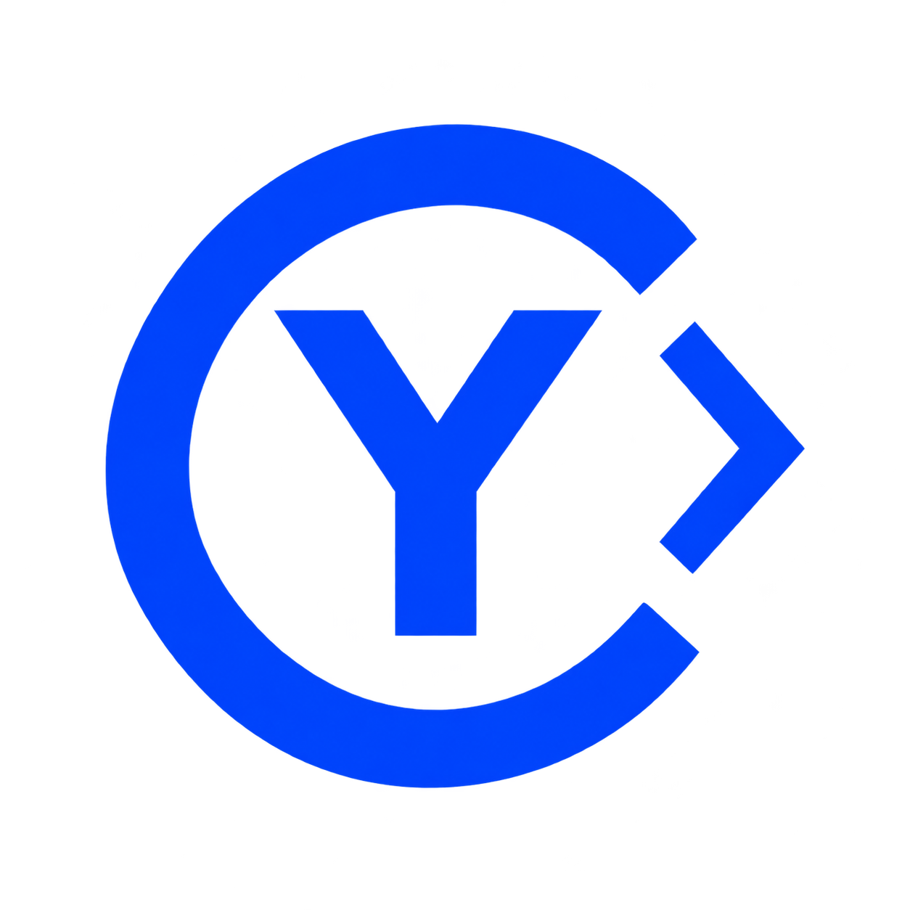

# CyCode — premier socle de développement

  

[Documentation](https://mrmybal.github.io/CyCodeReader/cycode/#/fr/overview) · [English documentation](https://mrmybal.github.io/CyCodeReader/cycode/#/en/overview)

CyCode dispose d’une gestion des mises à jour GitHub avec reprise ou téléchargement
neuf, vérification SHA-256 et indications en français et en anglais. L’espace
supplémentaire est contrôlé avant le transfert, le repli complet et la préparation.
La vue distingue les octets reçus, la vérification et les fichiers prêts ; elle
indique un débit et un temps de transfert approximatifs. Les fichiers incomplets,
l’historique et les sauvegardes sont conservés. L’installation reste explicite,
après l’enregistrement et la fermeture habituels. L’extraction et le remplacement
ont leurs propres contrôles d’espace, avec vérification du retour arrière et
protection du marqueur de récupération. La restauration vérifie son espace et prépare
toutes les copies avant de déplacer les fichiers installés. Une reprise réutilise
les copies vérifiées de la transaction active et conserve les anciennes copies modifiées.
Le helper affiche les étapes et compteurs, permet un arrêt coopératif et attend la
fin du travail avant de fermer la fenêtre. Le résultat distingue les fichiers déjà
déplacés pendant cette tentative et propose un rapport à copier ; un reçu lié à la
transaction est conservé lorsque possible. La validation graphique réelle reste à faire. Voir
[Installation](app/Docs/UpdateInstallation.md) et [Récupération](app/Docs/UpdateRecovery.md).
L’[historique détaillé](app/Docs/UpdateHistory.md) ajoute une inspection explicite des
métadonnées d’installation/restauration, avec filtres CyUI, catégories, dates, pages
et copie d’une entrée sélectionnée. Il ne lit pas les archives ou sauvegardes et
signale ses limites ; les reçus ne prouvent pas l’état actuel de l’installation.
Les validations réelles restent à faire ; voir [Mises à jour](app/Docs/Updates.md),
[Téléchargements](app/Docs/UpdateDownloads.md), [Récupération](app/Docs/UpdateRecovery.md)
et [Stockage](app/Docs/UpdateStorage.md).

Lancer **CyCode.exe**. Le programme ouvre une interface native C++ utilisant CyUI.
CyCode est sous [GNU GPL v3 uniquement](LICENSE) (`GPL-3.0-only`).
Copyright (c) 2026 Cyberalien ; voir [COPYRIGHT](COPYRIGHT).
Les dépendances conservent leurs propres licences.

Le cook et le packaging Unreal possèdent maintenant un aperçu, le choix des
cartes et conteneurs, un délai maximal et l’annulation par le moteur de build
commun. Chaque lancement garde ses journaux et sa propre archive, avec les mêmes
services côté MCP/plugins. La validation réelle avec Unreal/interface reste à
faire ; voir [Automatisation Unreal](app/Docs/UnrealAutomation.md).

L’historique permet maintenant de préparer un cherry-pick ou un revert d’un
commit, puis de poursuivre après résolution des conflits ou quitter le suivi en
conservant les fichiers et l’index. Les contrôles et reçus persistants sont partagés
avec le SDK/MCP et les plugins. La validation réelle Git/interface reste à faire ;
voir [Reprise de commits Git](app/Docs/GitReplay.md).

La vue Fusion Git regroupe les blocages, les conflits et la revue des fichiers
préparés. Un aperçu précède le commit de fusion non signé ou la sortie du suivi
de fusion qui conserve fichiers et index. L’interface, le SDK/MCP et les plugins
ABI2 partagent ce service et ses reçus persistants. Compilation Windows et schémas
vérifiés ; validation réelle Git/interface encore nécessaire. Voir
[Fusion Git](app/Docs/GitMergeWorkflow.md).

La synchronisation des fichiers après résolution Git possède maintenant un aperçu,
une sauvegarde persistante dans la corbeille et une annulation protégée. Elle copie
les octets préparés ou retire un fichier absent de l’index, sans conversion de
texte. La validation réelle Git/fichiers/interface reste à effectuer ; voir
[Fichiers locaux Git](app/Docs/GitWorkingFiles.md).

Les conflits Git disposent maintenant d’un catalogue des versions réelles, d’une
inspection adaptée aux binaires et d’une résolution examinée dans l’index, avec
suppression d’entrées et choix groupés des chemins d’un renommage. Les fichiers
locaux et les documents ouverts sont conservés. La validation réelle Git/interface
reste à effectuer ; voir [Conflits Git](app/Docs/GitConflicts.md).

Le lancement en débogage Java/Maven/Gradle utilise maintenant le débogueur partagé,
avec JDT LS et le module Microsoft java-debug installé séparément. La compilation
Windows et les schémas sont vérifiés ; l’exécution Java et la validation graphique
restent à effectuer. Voir [Débogage Java](app/Docs/JavaDebugging.md).

L’attachement JDWP à une JVM locale ou distante utilise des champs hôte/port
mémorisables et les mêmes vues de débogage. L’arrêt demande une déconnexion sans
terminer cette JVM ; la validation réelle du réseau et du débogueur reste à faire.

Une toolchain Rustup installée peut maintenant être sélectionnée dans les tâches
Cargo puis appliquée à l’analyse Rust. Le nom est conservé dans les profils, sans
modifier les réglages globaux de Rustup ni demander d’installation. Voir
[les toolchains Rust](app/Docs/RustToolchains.md) pour les prérequis et les essais
en exécution encore nécessaires.

Les options Cargo compatibles peuvent aussi être appliquées explicitement à
l’analyse Rust, avec mémorisation locale ou pour la session seulement. Le manifeste,
les features et les options hors ligne/verrouillées sont transmis au serveur sans
remplacer les réglages bruts. Voir [l’analyse Rust](app/Docs/RustAnalysis.md) pour
les limites et la validation en exécution encore nécessaire.

Le panneau des tâches Cargo propose maintenant le workspace entier, les features,
les profils personnalisés et les cibles bin/example/lib/test/bench. Le moteur partagé
contrôle l’identité des exécutables et invalide les caches incomplets. Voir
[Cargo](app/Docs/CargoBuilds.md) pour les options et limites : compilation Windows
effectuée, nouveaux scénarios en exécution et interface encore à valider.

Les modifications de texte annotées par un serveur de langage affichent maintenant
leurs libellés et les fichiers concernés avant application. Les confirmations
requises sont liées à chaque aperçu et contrôlées aussi par le SDK/plugins.
Voir les [modifications annotées](app/Docs/ChangeAnnotations.md) pour les limites
et la validation en exécution encore nécessaire.

Les sessions conservent maintenant le retour à la ligne, les replis visibles du
code et le cadrage/filtrage des images, avec contrôle du contenu et des dimensions.
Voir les [sessions](app/Docs/WorkspaceSessions.md) pour les limites et les
vérifications graphiques encore nécessaires.

La coloration sémantique négocie désormais les mises à jour différentielles des
serveurs de langage compatibles, avec cache borné et retour à une requête complète
en cas d'échec. L'éditeur et le SDK/plugins partagent ce service. Les gains et
le comportement réel restent à vérifier ; voir les
[mises à jour sémantiques](app/Docs/SemanticTokenUpdates.md).

Les presets CMake de tests, de paquets et de workflows ont maintenant une vue
avec aperçu des étapes, exécution et annulation communes au SDK et aux plugins.
Voir les [actions des presets](app/Docs/CMakePresetActions.md) pour leur utilisation
et les vérifications en exécution encore nécessaires.

Les commandes de navigation proposent désormais les hiérarchies d’appels et de
types : appelants, fonctions appelées, types parents/dérivés et sites d’appel,
selon les capacités du serveur de langage actif. Les vues, le SDK/MCP et les
plugins utilisent le même service natif. Voir les [hiérarchies](app/Docs/Hierarchies.md)
pour les raccourcis, limites et vérifications encore nécessaires.

Le panneau de contrôle de versions permet maintenant de choisir un dépôt Git
imbriqué et de gérer ses worktrees : création, verrouillage et suppression d’un
checkout propre. Les mêmes services sont exposés au SDK/MCP. Voir les
[dépôts Git et worktrees](app/Docs/GitWorktrees.md) pour les limites et la validation
native/graphique encore nécessaire.

**Fichier > Nouveau document texte** ouvre un brouillon sans créer de fichier.
Enregistrer sous écrit un nouveau fichier du projet en conservant l’onglet et son
historique Undo. Les brouillons vides sont aussi protégés par les points de
récupération ; leur restauration reste explicite dans Recovery. Voir les
[documents sans fichier](app/Docs/UntitledDocuments.md) pour les limites et la
validation native/graphique encore nécessaire.

Le panneau **Extensions > Paquets d’extension** gère les dossiers de paquets signés :
inspection des permissions, confiance explicite envers l’éditeur, installation/mise
à jour, retrait, retour à une version précédente et nettoyage des versions inutilisées.
Les versions restent figées dans chaque processus jusqu’au redémarrage, y compris
lors d’un changement de projet. Voir les [paquets d’extension](app/Docs/PluginPackages.md)
pour le format, le SDK et les validations réelles encore à effectuer.

Le build de développement ajoute la [restauration des sessions](app/Docs/WorkspaceSessions.md)
(onglets, positions, panneaux et disposition, indépendants par instance),
l’[inspection avancée DAP](app/Docs/AdvancedDebugging.md) (fonctions/exceptions,
variables paginées, registres, mémoire et désassemblage) et les
[tâches Maven/Gradle](app/Docs/JvmBuilds.md) avec leurs vrais outils et modèles
de dépendances. Compilation Windows vérifiée ; les nouveaux parcours réels et
graphiques restent à valider pendant l’interruption des tests natifs liée à l’antivirus.
La [compilation HLSL/GLSL](app/Docs/ShaderBuilds.md) rejoint aussi les tâches de projet,
avec DXC/glslang installés séparément, macros/inclusions, diagnostics et sorties
DXIL/SPIR-V. La prévisualisation GPU et l’environnement des shaders Unreal restent à réaliser.

Version **0.2.0** : [notes de version](CHANGELOG.md) et
[téléchargements GitHub](https://github.com/MrMybal/CyCode/releases).
Extraire le ZIP complet dans un dossier accessible en écriture, puis lancer CyCode.exe.
Le runtime Visual C++ 2022 x64 et un pilote OpenGL 3.3 sont nécessaires.
Le paquet inclut la recherche ripgrep ; les serveurs de langage, compilateurs,
débogueurs et le runtime MCP privé nécessitent leur installation séparée.
Le plugin Subversion est inclus dans le build de développement : choisir son
fournisseur dans Contrôle de versions et mapper la racine de la copie SVN. Le client
SVN s’installe séparément. Les opérations réelles restent à valider ; voir
[Subversion](app/Docs/Subversion.md).
Le plugin [Perforce](app/Docs/Perforce.md) est aussi inclus : checkout, changelists,
comparaisons, soumission et retour arrière d’un fichier, verrous et synchronisation
du projet sans modifications. Le client P4 doit être installé et configuré ; les
échanges réels avec un serveur restent à valider.
Le plugin [Mercurial](app/Docs/Mercurial.md) est inclus : statut, comparaisons,
historique/annotations, ajout/retrait du suivi/retour arrière d’un fichier, commits,
mise à jour sans modification suivie, signets/branches nommées et pull/push via les
remotes configurés. Le client Hg doit être installé ; la compilation Windows est
validée, les opérations réelles et l’interface restent à vérifier.
Le plugin [Diversion](app/Docs/Diversion.md) est ajouté au build de développement :
statut, différences, historique/annotations, commits, branches, mise à jour et
verrous. Il respecte la synchronisation automatique de Diversion. Le client et sa
connexion doivent être configurés séparément ; les échanges réels restent à valider.
Le [contrat de fournisseur](app/Docs/CustomVersionControl.md) pourra accueillir ton
futur système de contrôle de versions avec ses propres actions et menus.

La bibliothèque [CyUI](https://github.com/MrMybal/CyUI), encore privée, est sous
[licence MIT](https://github.com/MrMybal/CyUI/blob/ff023e646c6a3038b3dfbfd53f6d2b4a2f5955e3/LICENSE).
Une [copie locale de sa licence](app/licenses/CyUI.txt) est fournie.

- **Fichier > Ouvrir une solution** : ouvrir directement un `.sln`, `.slnx` ou `.uproject` ; un dossier reste possible.
- **Ctrl+Alt+F** : retrouver un fichier ; **double Maj** : rechercher partout.
- Profil **Rider** : **Ctrl+N** cherche un type, **Alt+Inser** crée un fichier,
  **Ctrl+Maj+A** cherche une action. Les profils Visual Studio et VS Code sont sélectionnables.
- **Ctrl+S** : enregistrer ; **Ctrl+F** : rechercher/remplacer dans le document.
- **F12** : aller à la définition C/C++ ; **Maj+F12** : rechercher les références.
- Menu **Navigation** et panneau **Références** : afficher et ouvrir les emplacements trouvés.
- **Ctrl+Maj+F** : recherche dans le projet avec ripgrep.
- Panneau **Gestion de versions** : différences, préparation, commits, branches,
  historique, remotes, fetch/pull/push, stashes et conflits de texte à trois versions.
- Profil Rider : **Ctrl+K** ouvre les commits ; **Ctrl+Maj+K** ouvre la synchronisation Git.
- **Alt+F12** : terminal interactif PowerShell/cmd, plusieurs sessions et fenêtres détachables.
- Menu **Exécuter** : lancer, déboguer et configurer un exécutable ou une assembly .NET.
  La configuration du débogueur peut aussi sélectionner un adaptateur DAP fourni
  par un plugin, avec ses options JSON. L’extension Unreal propose CodeLLDB ;
  voir les [débogueurs des plugins](app/Docs/PluginDebuggers.md) et leurs limites de validation.
  Les débogueurs C++ et C# proposent points d'arrêt, conditions, pile, variables,
  espions et pas à pas. Les logpoints dépendent du moteur ; NetCoreDbg ne les propose pas.
- Profil Rider : **Maj+F9** débogue, **Maj+F10** exécute, **F8** passe au pas suivant,
  **F7** entre dans une fonction, **Ctrl+F2** arrête, **Ctrl+F8** bascule un point d'arrêt.
- Panneau **Compilation** : lancer la configuration ou la compilation et consulter la sortie copiable.
- **Compilation > Reglages CMake** : détecter les toolchains, choisir le compilateur,
  le générateur, la configuration et la cible, puis configurer et compiler.
- Le panneau CMake sélectionne aussi les presets de configuration/compilation.
  Les délais CMake/MSBuild/Unreal sont réglables dans les préférences.
  Voir les [formats de projet](app/Docs/ProjectFormats.md).
- Les diagnostics associés à une version précise du texte sont soulignés dans
  l’éditeur, avec leur message au survol. Les rapports sans version restent dans
  Problèmes. Voir les [diagnostics de l’éditeur](app/Docs/EditorDiagnostics.md).
- Les plugins ABI2 peuvent s’abonner aux changements des documents, ressources et
  compilations par le [journal commun d’événements](app/Docs/Events.md).
  La validation d’exécution des ajouts récents reste suspendue après les
  suppressions d’exécutables de tests par Kaspersky.
- Panneau **MSBuild** : compiler directement une solution Visual Studio ou un projet
  C++/.NET, choisir configuration/plateforme et projet, nettoyer/recompiler/restaurer.
  **Préparer l'analyse MSBuild** transmet les includes et définitions C++ à clangd.
  Les erreurs de compilation avec position apparaissent dans **Problèmes**.
- Panneau **MCP** : copier la configuration de connexion à l'instance ouverte. Les assistants utilisent CyToolsCore.
- **Options** : langue EN/FR, Graphite et cinq thèmes CyUI, taille du texte et raccourcis personnalisables.

Clangd fournit la complétion C/C++, les diagnostics, les définitions et les références.
Roslyn fournit ces services pour C#, avec les références entre projets .NET, la
recherche de types/membres, le renommage avec aperçu et le formatage. Son serveur
et son SDK .NET d'analyse sont installés dans le runtime privé du projet ; les
installations globales ne sont pas modifiées. Le débogage C#/.NET utilise NetCoreDbg,
avec sélection automatique du moteur et du runtime à partir du programme compilé.
Les DLL exécutables figurent parmi les artefacts évalués du panneau MSBuild ;
elles peuvent alimenter le profil du débogueur. Le parcours console .NET 8 avec
symboles PDB portables est testé. La sortie apparaît dans la console de débogage ;
pour saisir du texte au clavier dans le programme, utiliser **Exécuter sans débogage**.
Le MCP partage ce service et les modifications non enregistrées avec l'interface.
Les en-têtes des SDK/Unreal enregistrés s'ouvrent en lecture seule.
La coloration C++/Unreal distingue directives bleues, chemins et chaînes orangés,
types violets, fonctions turquoise, macros et métadonnées de réflexion ; les
commentaires restent verts. Les mots-clés C++ comme `static`, `bool` et `const`
partagent la même couleur. La palette est adaptée aux thèmes sombres et clairs.
Clangd et Roslyn complètent cette coloration avec les symboles réels : alias,
fonctions, variables, paramètres, champs et constantes d'énumération. Clangd atténue
aussi les branches de préprocesseur inactives. Les anciennes couleurs d'analyse
sont écartées dès qu'un document change ; la coloration immédiate reste disponible.
Le renommage C++ multi-fichier dispose d'un aperçu, d'une application aux buffers
et d'une annulation.
Une configuration CMake réussie transmet ses includes
et macros au service de langage. Ninja fournit sa base compile_commands.json ;
avec Visual Studio, CyCode construit une base d'analyse depuis les métadonnées CMake.
Le profil local est conservé dans .cycode/build.json. Pour changer de compilateur
ou de générateur, choisir un nouveau dossier de compilation.
Git et CMake sont des outils externes détectés. Ripgrep, CodeLLDB et NetCoreDbg sont installés
dans runtime/tools par le script de build, avec versions et empreintes verrouillées.
Le dossier app/examples/hello contient un petit projet CMake pour essayer la compilation.

Cette version est un jalon utilisable, pas une parité fonctionnelle avec Rider.
Le terminal et les débogueurs C++/.NET sont exécutés et testés sur Windows.
Les autres frameworks .NET, Rust/Java/web, les aperçus shaders/web, les refactorisations plus larges,
les workflows VCS restants et la validation Linux/macOS restent à réaliser.
L'éditeur accepte actuellement les fichiers UTF-8 jusqu'à 4 Mio.

Les données et préférences sont dans data/, les dépendances et builds dans runtime/.
Ne pas déplacer runtime/python après installation : son environnement est créé pour
ce chemin. La distribution actuelle est un build de développement Windows ; elle
n'est pas encore un installeur autonome testé sur une machine vierge.

Instructions développeur : [app/README.md](app/README.md).
Une compilation ordinaire ne génère ni ne lance les exécutables de test.
`python app/scripts/verify_sources.py` vérifie les sources sans exécutable natif.
Les tests natifs sont séparés et optionnels ; ils sont suspendus localement après
les suppressions signalées par Kaspersky. Voir [les vérifications](app/Docs/Testing.md).
État précis et preuves : [app/Docs/Validation.md](app/Docs/Validation.md).
Toolchains et limites CMake : [app/Docs/Build.md](app/Docs/Build.md).
Exécution et limites du débogueur : [app/Docs/Execution.md](app/Docs/Execution.md).
Git et conflits : [app/Docs/VersionControl.md](app/Docs/VersionControl.md).
Solutions et projets Visual Studio : [app/Docs/MSBuild.md](app/Docs/MSBuild.md).
Services C# et limites : [app/Docs/CSharp.md](app/Docs/CSharp.md).
