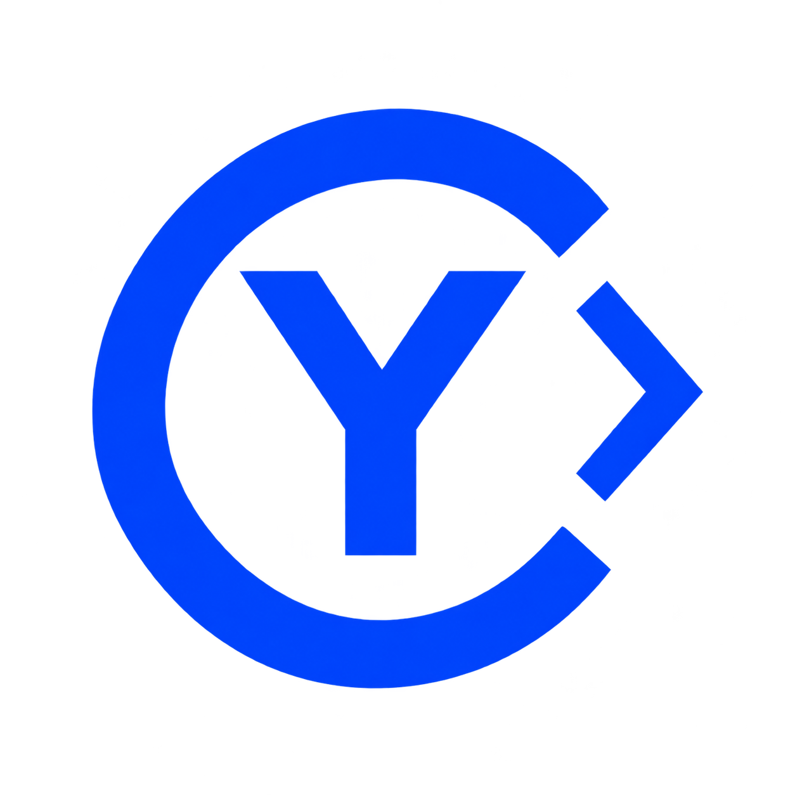
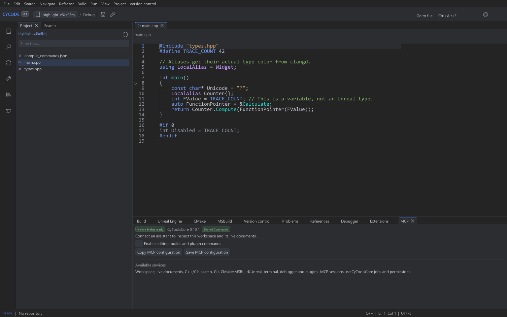
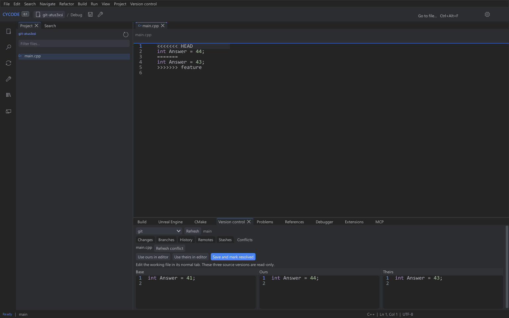

> **Architecture en cours de séparation :** ce dépôt devient CyCode Core, le moteur natif commun. L’interface est dans [CyCodeIDE](https://github.com/MrMybal/CyCodeIDE). Les téléchargements 0.2.3 et les captures ci-dessous concernent la version historique de l’IDE. Voir [la migration](app/Docs/CoreExtraction.md).

<table width="100%">
  <tr>
    <td width="300" align="left" valign="top">
      <a href="https://mrmybal.github.io/CyCode/?lang=fr">Présentation</a><br>
      <a href="https://mrmybal.github.io/CyCode/Documentation.html#/fr/overview">Documentation</a><br>
      <a href="https://github.com/MrMybal/CyCode">GitHub</a><br><br>
      <sub>README</sub><br>
      <a href="README.md">English</a> · <a href="README.fr.md">Français</a>
    </td>
    <td width="400" align="center" valign="middle">
      <a href="https://mrmybal.github.io/CyCode/?lang=fr"></a>
    </td>
    <td width="300" align="right" valign="top">
      <p><sub>Licence de l’application</sub><br><a href="LICENSE"><strong>GPL-3.0-only</strong></a></p>
      <p><sub>Version</sub><br><a href="VERSION.fr.md"><strong>0.2.3</strong></a><br><strong>ALPHA</strong></p>
      <p><a href="https://github.com/MrMybal/CyCode/releases/download/v0.2.3/CyCode-0.2.3-windows-x64-setup.exe"><strong>Installer CyCode</strong></a><br><sub>Windows x64</sub><br><a href="https://github.com/MrMybal/CyCode/releases/download/v0.2.3/CyCode-0.2.3-windows-x64.zip">ZIP portable</a></p>
    </td>
  </tr>
</table>

<h1 align="center">CyCode</h1>

Un IDE natif pour les développeurs qui travaillent en C/C++, sur Unreal Engine
et sur d’autres types de projets. Modifiez le code, parcourez une solution,
compilez avec vos outils, déboguez et examinez les changements dans un espace
de travail construit avec CyUI.

> **ALPHA · 0.2.3**
>
> Une version expérimentale destinée aux essais et aux retours. Certaines fonctions
> restent incomplètes ou dépendent d’outils externes. La version 0.2.3 ajoute l’installateur Windows
> et un paquet commun pour la version portable et les mises à jour. Consultez les
> [notes de version et limites connues](VERSION.fr.md).

[](website/assets/workspace.png)

*Capture réelle d’une version de développement sur un projet d’exemple.
La disposition et les outils disponibles peuvent différer du paquet téléchargeable.*

## À propos de CyCode

Ouvrez une solution Visual Studio, un espace de travail CMake ou un projet
Unreal, puis gardez ensemble l’éditeur, l’arbre du projet, la sortie de compilation,
le terminal et les outils de contrôle de versions. Les panneaux détachables sont
de véritables fenêtres déplaçables sur un autre écran ; des instances distinctes
de l’application peuvent ouvrir différents projets.

La coloration et les services sémantiques sont distincts. Complétion, navigation
des symboles, diagnostics, formatage et refactorisations utilisent un serveur
de langage compatible installé. Les tâches de compilation invoquent les vrais
outils du projet ; le débogage utilise un adaptateur DAP compatible. CyCode ne
revendique pas une parité complète avec Rider, Visual Studio ou VS Code.

[](website/assets/git-conflicts.png)

## Fonctionnalités

- **Code et navigation** : syntaxes, repli du code, thèmes, recherche dans le document
  ou le projet, recherche de fichiers et recherche universelle. Les profils de
  raccourcis Rider, Visual Studio et VS Code sont sélectionnables.
- **Projets et compilation** : `.sln`, `.slnx`, CMake et Unreal, avec choix de
  configuration/cible et sortie de compilation. Cargo, npm, Java, Maven et Gradle
  disposent de tâches propres à leur type de projet.
- **Services de langage** : C/C++, C#/.NET, Rust, Java, web et autres serveurs
  configurés, selon les capacités de chacun. La compilation HLSL/GLSL utilise
  DXC/glslang installés ; la prévisualisation GPU des shaders reste un chantier distinct.
- **Contrôle de versions** : Git intégré avec différences, préparation des commits,
  branches, historique et examen des conflits. Les fournisseurs natifs peuvent
  sélectionner Perforce, SVN, Mercurial ou Diversion par chemin de projet ; leurs
  propres clients/services sont nécessaires.
- **Exécution et inspection** : terminaux interactifs et débogage DAP, avec points
  d’arrêt, pile d’appels, variables et outils d’inspection selon l’adaptateur.
- **Extensions et automatisation** : les plugins natifs ABI2 peuvent ajouter
  commandes, panneaux, services de langage, outils de projet et contrôle de versions.
  L’intégration SDK/MCP CyToolsCore, optionnelle, partage les services natifs de
  l’IDE. Les plugins natifs s’exécutent comme du code de confiance dans l’application.
- **Espace de travail et aide** : fenêtres multiples, sessions, aperçus d’images en
  lecture seule, interface anglais/français et manuel CyDoc avec recherche et
  ressources locales.

Le développement local approfondit la navigation entre en-têtes/sources C++ et
les catalogues d’extraits. Ces ajouts ne sont pas livrés dans la version 0.2.3 et
restent séparés de cet instantané publié des sources. Le [guide développeur](app/README.md)
et l’[historique des changements](CHANGELOG.md) décrivent l’implémentation publiée
et ses limites.

---

## Installation

1. [Télécharger l’installateur Windows](https://github.com/MrMybal/CyCode/releases/download/v0.2.3/CyCode-0.2.3-windows-x64-setup.exe), exécuter Setup pour l’utilisateur courant, puis ouvrir CyCode depuis le menu Démarrer.
2. Pour une copie portable, [télécharger le ZIP complet](https://github.com/MrMybal/CyCode/releases/download/v0.2.3/CyCode-0.2.3-windows-x64.zip), l’extraire dans un dossier accessible en écriture et lancer `CyCode.exe`.

Windows 10/11 x64 et un pilote OpenGL 3.3 sont requis. Le runtime MSVC est fourni.
L’installateur utilise normalement `%LOCALAPPDATA%/Programs/CyCode` ; `data/` et
l’éventuel `runtime/` restent dans cette installation et sont conservés à la désinstallation.

CyCode vérifie GitHub Releases au démarrage par défaut, propose les nouvelles
versions, puis télécharge et vérifie l’installateur pour les copies installées ou le ZIP pour les copies portables, avant installation et redémarrage explicites. Aucun téléchargement `-update.zip` séparé n’est nécessaire.
Les préférences existantes sont conservées ; activez **Vérifier les mises à jour au
démarrage** dans le panneau de mise à jour si cette option était désactivée.
Les versions jusqu’à 0.2.2 nécessitent une première installation ou extraction
manuelle pour adopter le paquet partagé. Les versions suivantes utilisent le parcours intégré.

Les paquets Linux/macOS, l’exécution de l’installateur et le parcours complet de
mise à jour en ligne restent à valider. Voir les [notes de version](VERSION.fr.md).

## Sources, compilation et bibliothèques nécessaires

<details>
<summary>Compiler CyCode depuis les sources</summary>

### Prérequis

- Python 3.11+, Git, CMake 3.24+ et un compilateur C++20.
- Windows : Visual Studio 2022 avec les outils C++. Les compilations depuis les
  sources sous Linux/macOS nécessitent aussi Ninja et les bibliothèques de
  développement SDL3 de la plateforme ; leur validation graphique reste à effectuer.
- Les sources de l’[éditeur partagé CyCodeReader](https://github.com/MrMybal/CyCodeReader)
  et de [CyUI](https://github.com/MrMybal/CyUI), résolues aux révisions exactes
  indiquées par les fichiers de verrouillage. Seuls les modules UI sélectionnés
  sont compilés.
- Node.js 22+ et npm pour régénérer le manuel CyDoc embarqué. Ils ne sont pas
  nécessaires pour lire la documentation exportée.

### Récupérer les sources

```sh
git clone https://github.com/MrMybal/CyCode.git
cd CyCode
```

### Compiler et lancer

```sh
python app/scripts/fetch_dependencies.py
python app/scripts/build.py
```

Sous Windows, la compilation ordinaire copie `CyCode.exe` à la racine du dépôt.
Elle utilise les dépendances verrouillées et ne lance pas les tests natifs.
Le [guide développeur](app/README.md) détaille les compilations du noyau seul,
les sources de développement explicites, les prérequis par plateforme et les outils
optionnels.

Les paquets Windows construits depuis cette révision de développement incluent
le compagnon CyToolsCore/MCP isolé. Les versions publiées jusqu’à 0.2.3 et les
compilations Linux/macOS nécessitent encore l’installation séparée du runtime.
L’édition native reste indépendante. Consultez les [commandes de packaging](app/Docs/Build.md#redistributable-mcp-runtime)
et les [preuves de validation actuelles](app/Docs/Finalization.md).
Les compilateurs et adaptateurs de langage/débogage ont leurs propres prérequis.

Pour régénérer la documentation ou la vitrine :

```sh
python app/scripts/build_documentation.py
python website/build.py
python website/verify.py runtime/showcase
```

</details>

---

## Licence

**Les sources, la documentation et les exemples originaux de CyCode utilisent
la [GNU GPL v3 uniquement](LICENSE) (`GPL-3.0-only`).** Copyright © 2026 Cyberalien ;
voir [COPYRIGHT](COPYRIGHT). Les composants tiers conservent leurs propres licences.

### Bibliothèques tierces

| Bibliothèque · sources | Licence · texte | Utilisation / périmètre |
| --- | --- | --- |
| [CyUI](https://github.com/MrMybal/CyUI) | [MIT](app/licenses/CyUI.txt) | Interface native modulaire, code, différences, commandes, images et widgets communs. |
| [Éditeur CyCodeReader](https://github.com/MrMybal/CyCodeReader) | [GPL-3.0-only](https://github.com/MrMybal/CyCodeReader/blob/31ee97949620d62ede0c603e71094483c5c21531/LICENSE) | Sources verrouillées de l’éditeur commun ; CyCodeReader reste une application distincte. |
| [Dear ImGui](https://github.com/ocornut/imgui) · [TextEditor](https://github.com/goossens/ImGuiColorTextEdit) | [MIT](app/licenses/DearImGui.txt) · [MIT](app/licenses/TextEditor.txt) | Widgets natifs et intégration de l’éditeur par les bibliothèques communes. |
| [SDL3](https://github.com/libsdl-org/SDL) | [zlib](app/licenses/SDL3.txt) | Fenêtres natives, saisie et intégration du rendu. |
| [nlohmann/json](https://github.com/nlohmann/json) | [MIT](app/licenses/nlohmann-json.txt) | Modèles et protocoles JSON natifs. |
| [TinyXML2](https://github.com/leethomason/tinyxml2) | [zlib](app/licenses/TinyXML2.txt) | Données XML des projets et fournisseurs. |
| [libvterm](https://www.leonerd.org.uk/code/libvterm/) | [MIT](app/licenses/libvterm.txt) | Modèle d’écran du terminal. |
| [Monocypher](https://monocypher.org/) | [BSD-2-Clause OR CC0-1.0](app/licenses/Monocypher.txt) | Signatures des paquets de plugins natifs. |
| [Lexilla / Scintilla](https://github.com/ScintillaOrg/lexilla) · [SciTE](https://www.scintilla.org/SciTE.html) | [Lexilla](app/licenses/Lexilla.txt), [Scintilla](app/licenses/Scintilla.txt) et [notices permissives SciTE](app/licenses/SciTE-Properties.txt) | Lexers et propriétés de langage partagés. |
| [Tree-sitter et grammaires](https://github.com/tree-sitter) | [MIT et notices des grammaires](app/licenses/tree-sitter.txt) | Analyse syntaxique commune ; conserver aussi les notices de chaque grammaire. |
| [stb_image](https://github.com/nothings/stb) | [MIT OR Unlicense](app/licenses/stb.txt) | Décodage d’images. |
| [libwebp](https://github.com/webmproject/libwebp) | [Type BSD](app/licenses/libwebp-COPYING.txt) · [concession de brevets](app/licenses/libwebp-PATENTS.txt) | Décodeur WebP. |
| [ripgrep](https://github.com/BurntSushi/ripgrep) | [MIT OR Unlicense](https://github.com/BurntSushi/ripgrep/blob/15.2.0/COPYING) | Exécutable de recherche ; ses notices accompagnent l’archive Windows. |
| [PCRE2](https://github.com/PCRE2Project/pcre2) | [BSD-3-Clause WITH PCRE2-exception](https://github.com/PCRE2Project/pcre2/blob/6f9d7c1373262c541324a16a358785b33ef116cf/LICENCE.md) | Transformations d’extraits locales, hors application et sources publiées. |
| [utf8proc](https://github.com/JuliaStrings/utf8proc) | [MIT et conditions des données Unicode](https://github.com/JuliaStrings/utf8proc/blob/79cdd5ab40c79afa559f689ffc13b76812dee1ac/LICENSE.md) | Changement de casse Unicode des extraits en développement local. |
| [SDK CyToolsCore](https://github.com/MrMybal/CyToolsCore) | [MIT](app/licenses/CyToolsCore.txt) | Compagnon SDK/MCP commun ; inclus dans les nouveaux paquets Windows. |
| [SDK Python MCP](https://github.com/modelcontextprotocol/python-sdk) | [MIT](app/licenses/MCP-Python.txt) | Transport dans l’environnement Python MCP optionnel. |
| [CyDoc](https://github.com/MrMybal/CyDoc) | [MIT](https://github.com/MrMybal/CyDoc/blob/6ddf9a582defb2f11fbb3f992afef6f98dcadc93/LICENSE) | Lecteur embarqué avec les modules image/gallery, sans runtime Three.js. |
| [marked](https://github.com/markedjs/marked) · [PrismJS](https://github.com/PrismJS/prism) · [esbuild](https://github.com/evanw/esbuild) | [MIT](https://github.com/markedjs/marked/blob/v17.0.6/LICENSE.md) · [MIT](https://github.com/PrismJS/prism/blob/v1.30.0/LICENSE) · [MIT](https://github.com/evanw/esbuild/blob/v0.25.12/LICENSE.md) | Compilation et coloration de la documentation lors de la génération. |

Les serveurs de langage, outils .NET/Java/Rust et débogueurs sont des composants
externes optionnels avec leurs propres conditions, notamment MIT, Apache-2.0 avec
exceptions LLVM, EPL-2.0, GPL et les notices de leurs composants. Leurs périmètres
et textes conservés sont répertoriés dans les [notices tierces](app/THIRD_PARTY_NOTICES.md).
Ces tableaux ne remplacent pas les notices complètes livrées avec chaque distribution.

## Références et liens

- [Documentation](https://mrmybal.github.io/CyCode/Documentation.html#/fr/overview) · [Présentation](https://mrmybal.github.io/CyCode/?lang=fr).
- [Notes de version](VERSION.fr.md) · [Historique des changements](CHANGELOG.md) · [Téléchargements](https://github.com/MrMybal/CyCode/releases).
- [Dépôt des sources](https://github.com/MrMybal/CyCode) · [Suivi des problèmes](https://github.com/MrMybal/CyCode/issues).
- [CyCodeReader](https://github.com/MrMybal/CyCodeReader) — l’éditeur de code/texte indépendant qui partage la bibliothèque d’édition.

<details>
<summary><strong>AI Usage</strong></summary>

- [Commencer ici : instructions du projet](https://github.com/MrMybal/CyCode/blob/main/app/AGENTS.md) — architecture, services natifs et consignes du dépôt.
- [Compiler cette application](app/README.md) — prérequis, commandes de compilation et installation locale.
- [API des plugins](https://github.com/MrMybal/CyCode/blob/main/app/Docs/Plugins.md) · [Intégration SDK/MCP](https://github.com/MrMybal/CyCode/blob/main/app/Docs/MCP.md) — contrats d’extension et services communs.
- [Génération documentaire](https://github.com/MrMybal/CyCode/blob/main/app/.CyDocBuild/README.md) · [Génération de la vitrine](https://github.com/MrMybal/CyCode/blob/main/website/README.md) — régénérer le lecteur local et la présentation statique.

</details>
