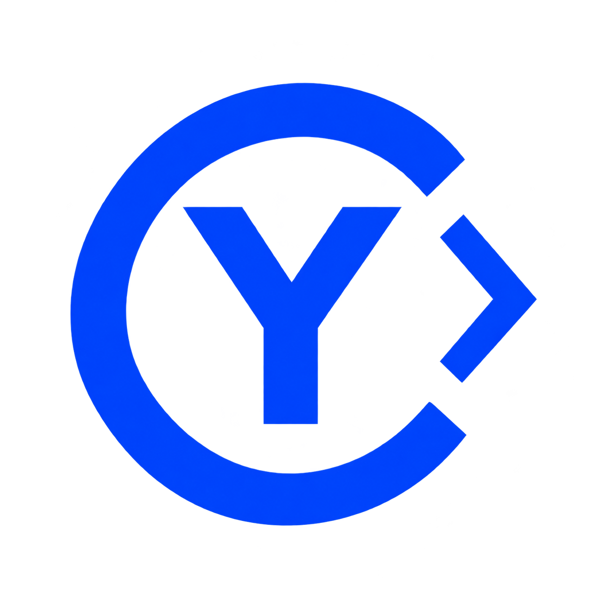
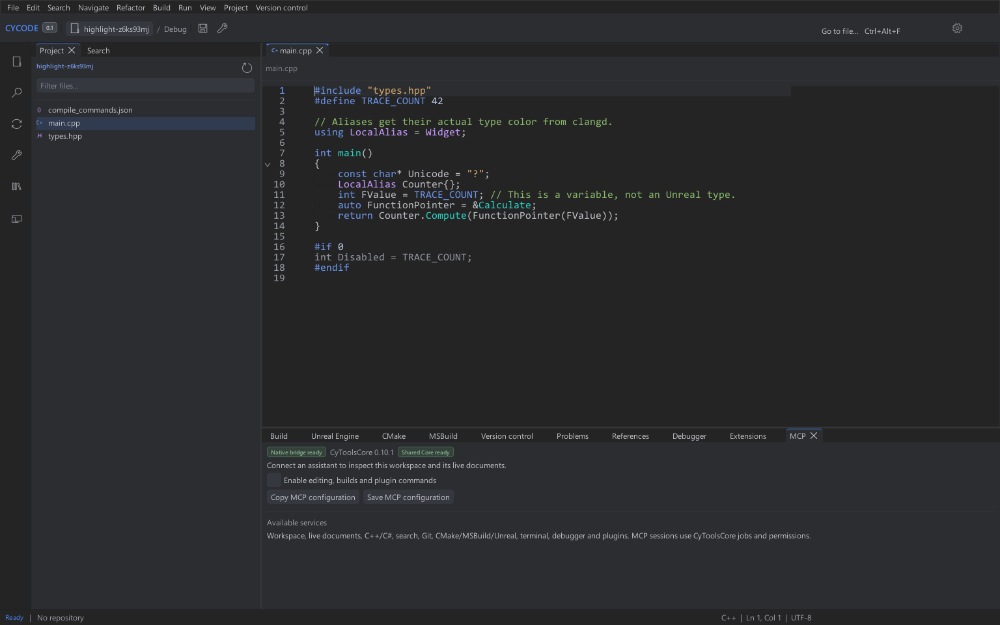
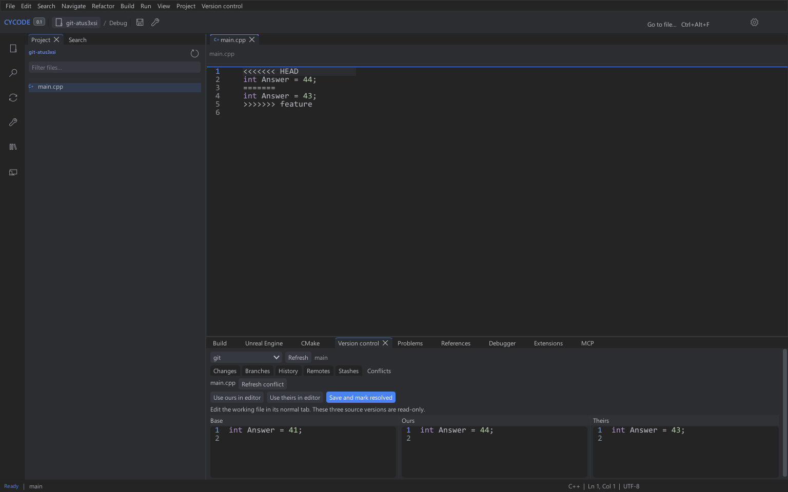

<table width="100%">
  <tr>
    <td width="300" align="left" valign="top">
      <a href="https://mrmybal.github.io/CyCode/">Website</a><br>
      <a href="https://mrmybal.github.io/CyCode/Documentation.html#/en/overview">Documentation</a><br>
      <a href="https://github.com/MrMybal/CyCode">GitHub</a><br><br>
      <sub>README</sub><br>
      <a href="README.md">English</a> · <a href="README.fr.md">Français</a>
    </td>
    <td width="400" align="center" valign="middle">
      <a href="https://mrmybal.github.io/CyCode/"></a>
    </td>
    <td width="300" align="right" valign="top">
      <p><sub>Application license</sub><br><a href="LICENSE"><strong>GPL-3.0-only</strong></a></p>
      <p><sub>Version</sub><br><a href="app/Docs/Releases/v0.2.3.md"><strong>0.2.3</strong></a><br><strong>ALPHA</strong></p>
      <p><a href="https://github.com/MrMybal/CyCode/releases/download/v0.2.3/CyCode-0.2.3-windows-x64-setup.exe"><strong>Install CyCode</strong></a><br><sub>Windows x64</sub><br><a href="https://github.com/MrMybal/CyCode/releases/download/v0.2.3/CyCode-0.2.3-windows-x64.zip">Portable ZIP</a></p>
    </td>
  </tr>
</table>

<h1 align="center">CyCode</h1>

A native IDE for developers working with C/C++, Unreal Engine and other project
types. Edit code, navigate a solution, build with your existing tools, debug and
review changes in one workspace built with CyUI.

> **ALPHA · 0.2.3**
>
> An experimental release for testing and feedback. Some features remain incomplete
> or depend on external tools. Version 0.2.3 adds the Windows installer and a shared
> portable/update package. Read the [release notes and known limitations](app/Docs/Releases/v0.2.3.md).

[](website/assets/workspace.png)

*Real development-build capture on a sample project. Layout and available tools
can differ from the downloadable release.*

## About CyCode

Open a Visual Studio solution, a CMake workspace or an Unreal project, then keep
the editor, project tree, build output, terminal and revision-control tools
together. Detached panels are native windows that can move to another display;
separate application instances can open different projects.

Language highlighting and semantic services are separate. Completion, symbol
navigation, diagnostics, formatting and refactorings use a compatible installed
language server. Build tasks invoke the project's real toolchain; debugging uses
a compatible DAP adapter. CyCode does not claim complete Rider, Visual Studio or
VS Code feature parity.

[](website/assets/git-conflicts.png)

## Features

- **Code and navigation:** syntax modes, folding, themes, document/workspace search,
  file lookup and Search Everywhere. Rider, Visual Studio and VS Code keyboard
  profiles are selectable.
- **Projects and builds:** `.sln`, `.slnx`, CMake and Unreal projects, with
  configuration/target selection and build output. Cargo, npm, Java, Maven and
  Gradle have project-specific tasks.
- **Language services:** C/C++, C#/.NET, Rust, Java, web and other configured
  servers, with capabilities determined by each backend. HLSL/GLSL compilation
  uses installed DXC/glslang tools; GPU shader previews remain separate work.
- **Revision control:** built-in Git with diffs, staging, branches, history and
  conflict review. Native providers can select Perforce, SVN, Mercurial or
  Diversion per project path; their own clients/services are required.
- **Run and inspect:** interactive terminals and DAP debugging, with breakpoints,
  stack frames, variables and adapter-dependent inspection tools.
- **Extensions and automation:** native ABI2 plugins can add commands, panels,
  language services, project tools and revision-control providers. Optional
  CyToolsCore SDK/MCP integration shares the IDE's native services. Native plugins
  execute as trusted code inside the application.
- **Workspace and help:** multiple windows, sessions, read-only image previews,
  English/French UI and a searchable CyDoc manual with local resources.

Local development continues on further C++ header/source navigation and snippet
catalogues. These additions have not shipped in 0.2.3 and remain separate from
this published source snapshot. The [developer guide](app/README.md) and
[changelog](CHANGELOG.md) describe the published implementation and its limits.

---

## Installation

1. [Download the Windows installer](https://github.com/MrMybal/CyCode/releases/download/v0.2.3/CyCode-0.2.3-windows-x64-setup.exe), run Setup for the current user and open CyCode from the Start menu.
2. For a portable copy, [download the complete ZIP](https://github.com/MrMybal/CyCode/releases/download/v0.2.3/CyCode-0.2.3-windows-x64.zip), extract it to a writable folder and run `CyCode.exe`.

Windows 10/11 x64 and an OpenGL 3.3 driver are required. The app-local MSVC runtime
is included. The installer normally uses `%LOCALAPPDATA%/Programs/CyCode`; `data/`
and optional `runtime/` stay in that writable installation and are retained by uninstall.

CyCode checks GitHub Releases at startup by default, proposes available versions,
and downloads/verifies Setup for installed copies or the portable ZIP for portable copies before an explicit install/restart.
There is no separate `-update.zip` download. Preserve existing startup-check
preferences; enable **Check for updates at startup** in Application updates if disabled.
Versions through 0.2.2 require this installer or portable extraction once to adopt
the shared package format. Subsequent versions use the built-in update flow.

Linux/macOS packages, installer execution and full online update acceptance remain
unverified. See the [release notes](app/Docs/Releases/v0.2.3.md).

## Source, build and required libraries

<details>
<summary>Build CyCode from source</summary>

### Requirements

- Python 3.11+, Git, CMake 3.24+ and a C++20 compiler.
- Windows: Visual Studio 2022 with the C++ workload. Linux/macOS source builds
  additionally need Ninja and the SDL3 platform development libraries; their GUI
  acceptance remains pending.
- The shared [CyCodeReader editor](https://github.com/MrMybal/CyCodeReader) and
  [CyUI](https://github.com/MrMybal/CyUI) sources, resolved at the exact revisions
  in the application's lockfiles. Only the selected UI modules are compiled.
- Node.js 22+ and npm to regenerate the bundled CyDoc manual. They are not needed
  to read the exported documentation.

### Get the source

```sh
git clone https://github.com/MrMybal/CyCode.git
cd CyCode
```

### Build and run

```sh
python app/scripts/fetch_dependencies.py
python app/scripts/build.py
```

On Windows, the normal build copies `CyCode.exe` to the checkout root. The build
uses pinned dependency sources and does not run native tests. See the
[developer guide](app/README.md) for core-only builds, explicit source overrides,
platform requirements and optional tool setup.

The optional MCP bridge needs the separately supplied CyToolsCore wheel and its
private Python environment. The desktop application itself runs without Python.
Language toolchains and adapters have separate installation requirements.

To regenerate documentation or the website:

```sh
python app/scripts/build_documentation.py
python website/build.py
python website/verify.py runtime/showcase
```

</details>

---

## License

**CyCode's original source, documentation and examples use [GNU GPL v3 only](LICENSE)
(`GPL-3.0-only`).** Copyright © 2026 Cyberalien; see [COPYRIGHT](COPYRIGHT).
Third-party components keep their own licenses.

### Third-party libraries

| Library · source | License · terms | Use / scope |
| --- | --- | --- |
| [CyUI](https://github.com/MrMybal/CyUI) | [MIT](app/licenses/CyUI.txt) | Modular native interface, code views, diffs, commands, images and shared widgets. |
| [CyCodeReader editor](https://github.com/MrMybal/CyCodeReader) | [GPL-3.0-only](https://github.com/MrMybal/CyCodeReader/blob/31ee97949620d62ede0c603e71094483c5c21531/LICENSE) | Pinned shared editor source; the standalone Reader is a separate application. |
| [Dear ImGui](https://github.com/ocornut/imgui) · [TextEditor](https://github.com/goossens/ImGuiColorTextEdit) | [MIT](app/licenses/DearImGui.txt) · [MIT](app/licenses/TextEditor.txt) | Native widgets and the editor integration through the shared libraries. |
| [SDL3](https://github.com/libsdl-org/SDL) | [zlib](app/licenses/SDL3.txt) | Native windows, input and rendering integration. |
| [nlohmann/json](https://github.com/nlohmann/json) | [MIT](app/licenses/nlohmann-json.txt) | Native JSON models and protocols. |
| [TinyXML2](https://github.com/leethomason/tinyxml2) | [zlib](app/licenses/TinyXML2.txt) | XML project and provider data. |
| [libvterm](https://www.leonerd.org.uk/code/libvterm/) | [MIT](app/licenses/libvterm.txt) | Terminal screen model. |
| [Monocypher](https://monocypher.org/) | [BSD-2-Clause OR CC0-1.0](app/licenses/Monocypher.txt) | Native plugin package signatures. |
| [Lexilla / Scintilla](https://github.com/ScintillaOrg/lexilla) · [SciTE](https://www.scintilla.org/SciTE.html) | [Lexilla](app/licenses/Lexilla.txt), [Scintilla](app/licenses/Scintilla.txt) and [SciTE permissive notices](app/licenses/SciTE-Properties.txt) | Shared syntax lexers and language properties. |
| [Tree-sitter and grammars](https://github.com/tree-sitter) | [MIT and grammar notices](app/licenses/tree-sitter.txt) | Shared syntax parsing; preserve the individual grammar notices too. |
| [stb_image](https://github.com/nothings/stb) | [MIT OR Unlicense](app/licenses/stb.txt) | Image decoding. |
| [libwebp](https://github.com/webmproject/libwebp) | [BSD-style](app/licenses/libwebp-COPYING.txt) · [patent grant](app/licenses/libwebp-PATENTS.txt) | WebP decoder. |
| [ripgrep](https://github.com/BurntSushi/ripgrep) | [MIT OR Unlicense](https://github.com/BurntSushi/ripgrep/blob/15.2.0/COPYING) | Search executable; the Windows archive retains its notices. |
| [PCRE2](https://github.com/PCRE2Project/pcre2) | [BSD-3-Clause WITH PCRE2-exception](https://github.com/PCRE2Project/pcre2/blob/6f9d7c1373262c541324a16a358785b33ef116cf/LICENCE.md) | Local snippet-transform work, outside the published application/source snapshot. |
| [utf8proc](https://github.com/JuliaStrings/utf8proc) | [MIT and Unicode data terms](https://github.com/JuliaStrings/utf8proc/blob/79cdd5ab40c79afa559f689ffc13b76812dee1ac/LICENSE.md) | Unicode snippet casing in local development. |
| CyToolsCore SDK — private distribution | [MIT](app/licenses/CyToolsCore.txt) | Optional local SDK/MCP runtime, supplied separately. |
| [MCP Python SDK](https://github.com/modelcontextprotocol/python-sdk) | [MIT](app/licenses/MCP-Python.txt) | Transport in the optional Python MCP environment. |
| [CyDoc](https://github.com/MrMybal/CyDoc) | [MIT](https://github.com/MrMybal/CyDoc/blob/6ddf9a582defb2f11fbb3f992afef6f98dcadc93/LICENSE) | Bundled reader with image/gallery modules; no Three.js runtime. |
| [marked](https://github.com/markedjs/marked) · [PrismJS](https://github.com/PrismJS/prism) · [esbuild](https://github.com/evanw/esbuild) | [MIT](https://github.com/markedjs/marked/blob/v17.0.6/LICENSE.md) · [MIT](https://github.com/PrismJS/prism/blob/v1.30.0/LICENSE) · [MIT](https://github.com/evanw/esbuild/blob/v0.25.12/LICENSE.md) | Build-time documentation compilation and highlighting. |

Language servers, .NET/Java/Rust toolchains and debugger adapters are optional
external tools with their own terms, including MIT, Apache-2.0 with LLVM
exceptions, EPL-2.0, GPL and component-specific notices. Their scopes and retained
license texts are indexed in [Third-party notices](app/THIRD_PARTY_NOTICES.md).
The tables do not replace the complete notices supplied with each distribution.

## References and links

- [Documentation](https://mrmybal.github.io/CyCode/Documentation.html#/en/overview) · [Website](https://mrmybal.github.io/CyCode/).
- [Release notes](app/Docs/Releases/v0.2.3.md) · [Changelog](CHANGELOG.md) · [Downloads](https://github.com/MrMybal/CyCode/releases).
- [Source repository](https://github.com/MrMybal/CyCode) · [Issue tracker](https://github.com/MrMybal/CyCode/issues).
- [CyCodeReader](https://github.com/MrMybal/CyCodeReader) — the independent code/text editor sharing the editor library.

<details>
<summary><strong>AI Usage</strong></summary>

- [Start here: project agent guide](https://github.com/MrMybal/CyCode/blob/main/app/AGENTS.md) — architecture, native services and project instructions.
- [Build this application](app/README.md) — requirements, build commands and local setup.
- [Plugin API](https://github.com/MrMybal/CyCode/blob/main/app/Docs/Plugins.md) · [SDK/MCP integration](https://github.com/MrMybal/CyCode/blob/main/app/Docs/MCP.md) — extension contracts and shared services.
- [Documentation toolchain](https://github.com/MrMybal/CyCode/blob/main/app/.CyDocBuild/README.md) · [Website build](https://github.com/MrMybal/CyCode/blob/main/website/README.md) — regenerate the local reader and static showcase.

</details>
