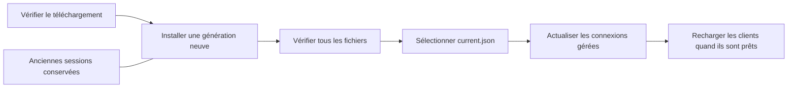

Le gestionnaire des sources actuelles utilise **CyUI Core** dans une application
distincte du moteur. Il propose les vues agents/skills, dépendances et mises à
jour, en anglais/français, avec cinq thèmes, deux densités et adaptation au DPI.
Les préférences sont conservées par installation. Le Core reste sans interface.

## Dépendances privées {#dependencies}

La vue **Dépendances** détecte clangd, ripgrep, Git, CMake, .NET, clang-tidy et
lldb-dap sans les exécuter. Si clangd est absent, elle s’ouvre au premier état
chargé. Les autres outils facultatifs renvoient aux téléchargements officiels ;
leurs installateurs ne sont pas lancés automatiquement.

**Installer clangd pour Core** propose la version officielle Windows x64
**23.1.0** : **29 690 805 octets** à télécharger et **101 011 414 octets** extraits,
en-têtes intégrés et `LICENSE.TXT` compris. Le seul exécutable représente
51 872 768 octets. Vérifier la source, la destination et accepter la licence
Apache-2.0 WITH LLVM-exception avant de confirmer. CyToolsCore fournit le
téléchargement vérifié en taille/SHA-256, la reprise, la progression et l’annulation.
Les chemins de l’archive sont contrôlés avant extraction, les fichiers avant sélection.

La destination est `<CyCodeCore>/dependencies/clangd/23.1.0/`, à côté de
`versions/`. `dependencies/clangd/current.json` sélectionne une version conservée
lors des mises à jour du Core. Aucun changement du PATH global, du registre ou
des installations LLVM existantes. `CYCODE_CLANGD` reste prioritaire ; sinon le
Core préfère cette version privée aux emplacements embarqués/PATH/système.
Recharger les clients MCP après changement de version. `language_status` distingue
désormais `executablePresent`/`requiresInstallation` d’un serveur en attente de
démarrage à la première requête. Un compilateur reste nécessaire pour compiler.

## Découverte MCP compacte {#mcp-profile}

Les connexions nouvelles/actualisées utilisent **Code (compact)** : 16 opérations
courantes, la passerelle `op_core_invoke` et 21 contrôles officiels du SDK, soit
**38 outils au lieu de 278**. **Catalogue complet** conserve les noms individuels
des 257 opérations pour les clients qui les exigent.

Pour une capacité non annoncée, consulter une seule fois `cy_list_operations`,
puis le schéma précis avec `cy_describe_operation`. Appeler `op_core_invoke` avec
`parameters: {operationId: "<identifiant-canonique>", parameters: {...}}`.
Le véritable SDK valide les paramètres, permissions, ressources et propriétaires
de jobs de l’opération réelle. La passerelle n’ajoute aucun droit. Réutiliser les
schémas déjà reçus et éviter les découvertes complètes répétées ou le polling
spéculatif. Choisir `CYCODE_MCP_PROFILE` ou `--mcp-profile code|full` sans modifier
l’API native.

Avec le SDK épinglé, les métadonnées sérialisées représentent **108 132 octets**
en mode Code contre **1 570 677 octets** en mode complet, soit 93,1 % de moins.
Ce sont des octets, pas un nouveau résultat de mesure des tokens ou de la vitesse IA.

## Agents et skills {#agents}

Ouvrir **CyCodeCore Manager** dans le menu Démarrer après installation de la 0.1.4.
Il remplace CyCodeUpdater. L’installateur ne demande plus de projet et ne configure
aucun agent ni skill personnel à lui seul.

1. Sélectionner une ou plusieurs applications et la portée projet/utilisateur.
2. Choisir le skill, le MCP ou les deux. Un skill personnel seul ne demande aucun
   projet. Une connexion MCP reste attachée à un dossier de projet précis.
3. Conserver la lecture seule ou autoriser explicitement édition et compilation.
   VCS, plugins et paramètres gardent leurs permissions distinctes.
4. Prévisualiser les chemins, puis appliquer. Les autres serveurs et paramètres
   restent intacts ; des sauvegardes privées précèdent les écritures.
5. Recharger/approuver la connexion dans le client. La présence d’un fichier ne
   prouve pas qu’un outil MCP a été chargé ou utilisé.

Le pont MCP reste celui de CyToolsCore. Le lanceur attribue un dossier de jobs SDK
distinct à chaque hôte ; plusieurs clients et générations ne partagent pas les
données d’un runtime encore vivant. Le gestionnaire ne démarre pas Core pendant
la préparation ou l’application d’une configuration.

| Profil | MCP du projet | MCP personnel | Skill |
| --- | --- | --- | --- |
| Codex | `.codex/config.toml` | `~/.codex/config.toml` | `.agents/skills` ; l’ancien skill personnel géré dans `.codex/skills` est conservé |
| Claude Code | `.mcp.json` | `~/.claude.json` | `.claude/skills` |
| Cursor | `.cursor/mcp.json` | `~/.cursor/mcp.json` | `.cursor/skills` |
| VS Code / Copilot | `.mcp.json` | `~/.copilot/mcp-config.json` | `.github/skills` pour le projet, `~/.copilot/skills` personnel |
| VS Code Local, ancien format | `.vscode/mcp.json` | `%APPDATA%/Code/User/mcp.json` | mêmes emplacements de skills Copilot |
| Gemini CLI | `.gemini/settings.json` | `~/.gemini/settings.json` | `.gemini/skills` |
| Claude Desktop | indisponible | `%APPDATA%/Claude/claude_desktop_config.json` | pas d’installation locale de SKILL.md dans ce profil |

Codex utilise TOML ; VS Code Local utilise `servers`, les autres profils JSON
utilisent `mcpServers`. Claude Code et Copilot partagent l’entrée du projet dans
`.mcp.json`. Les commentaires JSONC et virgules finales du profil Local sont
préservés. La portée projet ignore un profil uniquement personnel en l’expliquant ;
elle n’écrit pas silencieusement une configuration globale.

Les emplacements de profils personnalisés, environnements distants et politiques
d’entreprise nécessitent une revue manuelle. Aucune règle d’approbation, de
confiance ou de filtrage d’outils n’est contournée.

**Actualiser les connexions gérées** prépare la migration vers le moteur sélectionné,
y compris pour les anciens reçus Codex. Une entrée modifiée ou non gérée est
conservée et signalée. Permissions et état désactivé sont retenus ; la migration
ne réécrit pas les skills personnalisés. **Retirer la connexion sélectionnée**
retire uniquement l’entrée MCP gérée, en conservant les autres paramètres et skills.

Reçus, sauvegardes et jobs sont privés dans les données locales utilisateur sous
`CyCodeCore/manager`, séparés par installation. Les sauvegardes peuvent contenir
des paramètres privés : elles ne font pas partie du dépôt ni des paquets.

## Mises à jour sans remplacement du moteur actif {#updates}

La vue Mises à jour vérifie GitHub à l’ouverture et sur demande. L’option de
vérification quotidienne à l’ouverture de Windows reste décochée dans Setup.
Il n’existe pas de service permanent. L’accès aux releases privées utilise
l’authentification GitHub disponible ; les échecs ne sont pas affichés « à jour ».

Après confirmation, le gestionnaire télécharge et vérifie le Setup, puis ouvre
l’assistant normal. Celui-ci copie tout dans un nouveau dossier
`versions/<version>-<génération>`. Il ne supprime ni n’écrase l’ancien moteur,
Python/MCP ou gestionnaire et n’arrête aucun processus. Une réinstallation de la
même version crée aussi un nouveau dossier. Une ancienne destination de version
est normalisée vers la racine d’installation.

La sélection `current.json` n’est publiée qu’après contrôle des fichiers. Une
activation échouée conserve la sélection précédente. Le gestionnaire attend le
Setup et vérifie la version réellement sélectionnée avant d’annoncer un succès.
L’actualisation des connexions gérées est une option visible distincte. Les
conflits sont séparés du succès d’installation ; les skills personnels restent
intacts. Le gestionnaire rouvre ensuite sa nouvelle version.

Enregistrer ou créer un checkpoint avant de recharger les clients : les anciennes
sessions gardent leurs buffers jusqu’à fermeture explicite. Les anciennes
générations et récupérations restent disponibles ; aucun nettoyage récursif ou
arrêt forcé n’est effectué. La désinstallation nécessite encore de fermer les
clients concernés. Le ZIP possède le lanceur `CyCodeManager.cmd`.

Le catalogue compte désormais 257 opérations (cinq pour l’index du projet) ; le contrat moteur reste à 0.2.3. Le gestionnaire
ne crée pas de nouvel éditeur, moteur sémantique ou ordonnanceur SDK.

## Vérification et limites {#validation}

La nouvelle fenêtre Windows/Direct3D 11 utilise CyUI, sa navigation clavier, ses
rôles de couleurs et ses dimensions adaptées au DPI. Compilation de production et
tests de fichiers/SDK sans processus natif sont distincts
de l’acceptation dans chaque application IA. Les connexions réelles des clients
Claude/Cursor/Copilot/Gemini et les fenêtres Linux/macOS ne sont pas revendiquées
comme testées. La validation visuelle et l’exécution de cette nouvelle interface
restent à faire. Les anciennes validations natives conservent leur provenance.

## Références des clients {#references}

Voir les formats officiels :
[Codex](https://learn.chatgpt.com/docs/build-skills),
[Claude MCP](https://code.claude.com/docs/en/mcp) et
[skills](https://code.claude.com/docs/en/skills),
[Cursor MCP](https://cursor.com/docs/mcp) et
[skills](https://cursor.com/help/customization/skills),
[VS Code MCP](https://code.visualstudio.com/docs/agents/reference/mcp-configuration) et
[skills](https://code.visualstudio.com/docs/agent-customization/agent-skills),
[Gemini MCP](https://geminicli.com/docs/tools/mcp-server/) et
[skills](https://geminicli.com/docs/cli/skills/).
