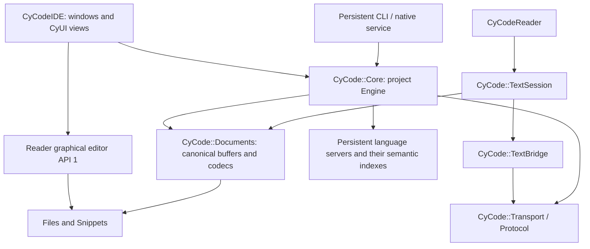

# CyCode native architecture and source integration

CyCode is the shared native C++20 library and headless service. CyCodeIDE owns the
desktop presentation; CyCodeReader owns its standalone editor presentation. The
existing Engine, language backends, project adapters, native plugins and guarded
transactions are reused. This development branch is not a new application release.

## Ownership



The native Core owns both project and standalone text profiles. They share
BufferState, encoding/newline primitives, guarded atomic I/O, native search,
process ownership, protocol envelopes and loopback transport. Reader's former
Document, Encoding, Search, Core, Plugins, NativeProcess and Bridge implementations
are retired from its build/source; compatibility headers retain its source names.
Core's duplicated app-level process sources/headers are retired too.

Project Engine retains workspace path restrictions, UTF-8 sources, identities,
revision issuance, recovery and multi-file transactions. TextSession retains
standalone paths, UTF-16/Windows-1252 support, read-only state, text transforms and
the existing text-plugin ABI. These are explicit profiles, not two semantic models.
Reader does not acquire project/LSP analysis just by linking the text profile.
Application-owned editor Undo/Redo and project change transactions are preserved.

## Source components

The root native source API, common source API and Reader graphical editor source
API are each version 1. These are source contracts, not a stable C++ binary ABI.
Use one pinned Core checkout per target graph; mixing Core copies is refused.

| Target | Responsibility |
| --- | --- |
| CyCode::Core | Existing project Engine, build/language/debug/VCS services and transactions |
| CyCode::Files | Paths and explicit guarded atomic text-file I/O |
| CyCode::Snippets | Native snippet parsing/expansion and byte ranges |
| CyCode::Documents | BufferState, codecs, Document and literal text search |
| CyCode::TextSession | Standalone live documents, revisions and text plugins |
| CyCode::TextBridge | Text-profile adapter for the common native protocol |
| CyCode::Process | Bounded argv-based processes, environment filtering and owned termination |
| CyCode::Transport | Authenticated loopback JSONL transport and endpoint lifecycle |
| CyCode::Protocol | Versioned request validation, typed failures and bounded response encoding |

Project plugins retain the versioned C ABI 1/2; text plugins retain their existing
ABI 1 names. Binaries from those two plugin profiles are not interchangeable. No
STL or ImGui object crosses either C boundary. Native plugins remain trusted code.

## Build and embed

```sh
python app/scripts/fetch_dependencies.py --core-only
cmake -S . -B runtime/core -DBUILD_TESTING=OFF
cmake --build runtime/core --config Release --target cycode_cli
```

Core fetch/configuration never requires Reader, CyUI, SDL, ImGui, OpenGL or
Tree-sitter. Native dependencies are pinned JSON, vterm, TinyXML2, Monocypher,
PCRE2 and utf8proc. The full Engine is the default. CLI, bundled providers and
update support default OFF when embedded; ordinary builds keep native tests OFF.

Text applications can fetch JSON only and select their components:

```sh
python app/scripts/fetch_dependencies.py --components TextSession TextBridge Process
cmake -S . -B runtime/text -DCYCODE_COMPONENTS="TextSession;TextBridge;Process" -DBUILD_TESTING=OFF
cmake --build runtime/text --config Release
```

An embedding may set CYCODE_COMMON_DEPS to its pinned dependency directory, include
`cmake/CyCodeComponents.cmake`, call `cycode_add_components(TextSession TextBridge)`
and link the explicit targets. Dependencies resolve automatically; unused optional
session/plugin or snippet libraries are not compiled. A full project host adds
the root Core directory and links CyCode::Core. Each Engine owns one project;
keep it alive across requests, join callers, then destroy it. TextSession does
not initialize project adapters or language workers.

## Native service contract

```sh
cycode_cli --disable-plugins <project> --stdio
cycode_cli <project> --serve <private-endpoint.json>
```

The stdio host emits a ready event, then accepts one bounded JSON object per line:

```json
{"protocol":"cycode-core/1","id":1,"method":"service.status","params":{}}
```

Responses preserve id/protocol and exactly result or error. Errors contain code,
message and optional details. Native owners emit RevisionConflict, DiskConflict,
ReadOnly, BackendUnavailable, Cancelled, DeadlineExceeded, CapacityExceeded and
UnsupportedOperation where migrated; other legacy runtime failures conservatively
remain OperationFailed. Classification never parses exception prose.

Request bound is 8 MiB; response bound is 20 MiB; string request IDs are at most
256 bytes. Stdio and socket output share one encoder. Oversized replies return a
correlated ResponseTooLarge. Socket transport bounds ordinary clients to eight,
with a control path for status/cancellation, timed reads and owned sockets. Failed
construction unwinds its resources; stopping joins handlers before borrowed state
can die. An old endpoint does not remove a newer instance's descriptor.

The descriptor protocols cycode-native/1 and cycodereader-native/1 remain compatible
and advertise coreProtocol. Text reports profile=text and no project analysis.
Protocol/id remain optional for legacy callers. Stdio service.shutdown or EOF
drains the host without saving buffers. Socket shutdown remains parent stdin/EOF;
these controls are not additional SDK/MCP operations. CyToolsCore still owns MCP,
jobs, identities, permissions and scheduling. One-shot CLI JSON remains legacy.

## Analysis and compilation context

service.status separates the service lifecycle from its Engine context.
language.status.servers reports each backend's configuration, observed launch,
initialization, capabilities, epoch, sent document revisions and version-bound
diagnostics. available means an observed running backend; an idle configured
command is not evidence of installation/readiness. Top-level ready/running remain
legacy aggregates; inspect the per-backend records. Sent revisions prove queued
notifications, not completed analysis. Whole-project index completeness is unknown.

CMake, MSBuild and Unreal continue to supply actual compiler commands, macros,
include/SDK/generated-file paths through their existing native adapters. clangd's
command model and index remain authoritative; path caches/literal search are
separate. Header command inference and background indexing have limits described
by [clangd compilation commands](https://clangd.llvm.org/design/compile-commands)
and [clangd indexing](https://clangd.llvm.org/design/indexing). Backend initialization
does not establish complete references across a project. Existing rename, code
actions and formatting retain previews, revisions, disk guards, explicit saves
and Undo; unsupported command-based transformations remain unavailable.

## Verified evidence and limits

Core d0b1791118c2d75eb85654dba8f8802560cebacd passed 63 native tests on each runner:
[Windows/Linux/macOS native run](https://github.com/MrMybal/CyCode/actions/runs/42485288416).
The Windows-only MSBuild test is skipped on POSIX. The macOS replay scenario also
passed three repeats. Earlier intermittent replay failures remain a diagnostic
item; a passing repeat is not a root-cause fix. This run includes the canonical Engine BufferState, shared I/O, component selection
and bounded native response changes. Changes after that revision require their own run.

Reader c4a013bb04ee77c43ac1be0bac51a6ec6c522976 passed seven tests on all three systems:
[native Reader integration](https://github.com/MrMybal/CyCodeReader/actions/runs/42485861029).
These include real text/native plugins, encodings, unsaved documents, revisions,
disk conflicts, Git plugin environment handling, IPC compatibility and EOF shutdown.
Windows production builds cover the CLI, minimal libraries and Reader GUI without
executing local app/test binaries. IDE presentation acceptance is a separate run.

[Semantic run at 28c455b](https://github.com/MrMybal/CyCode/actions/runs/42480779142)
completed both a deterministic synthetic workload and the actual Core CMake project
(121 translation units, 230 owned source/header files, 1,773,202 bytes). Raw reports
are retained in Benchmarks/semantic-baseline-28c455b. On that Linux runner, five real-project
warm samples gave medians of 8.88 ms definition, 8.79 ms references, 303.82 ms
completion and 18.55 ms rename preview; first version-bound diagnostics took 2.91 s.
Instantaneous CLI/descendant RSS summed to 1,234,755,584 bytes. Shared pages may be
counted more than once; this is neither peak nor private memory. These are recorded
responses, not complete-index coverage, universal performance or an IDE comparison.

The post-consolidation [d0b179 run](https://github.com/MrMybal/CyCode/actions/runs/42485288360)
also passed, using 121 translation units / 227 owned files / 1,769,912 bytes. Raw
reports are in Benchmarks/semantic-baseline-d0b179. Real-project warm medians were
9.31 ms definition, 8.74 ms references, 269.26 ms completion and 18.52 ms rename
preview; first version-bound diagnostics took 2.26 s. Unsaved edits followed by
fresh diagnostics and definition had a 550.76 ms median. The report records actual
result shapes (including two observed references), persistent context/backend
epoch, untouched disk sources and instantaneous summed RSS 1,182,777,344 bytes.
This is a second observation, not a controlled optimization claim: the owned
source corpus changed when unused copies were retired. Neither run establishes
complete semantic coverage or large Unreal/MSBuild acceptance.

Regenerate only on an explicit GitHub runner with benchmark_semantic.py --ci.
--prepare-only produces source data locally without native execution. Reports carry
raw samples, corpus/compiler identity, source revision, response shapes and scope.
Process-cold is not OS-cache cold. Native execution remains suspended locally while
the existing antivirus removals are unresolved; no exclusions/restores are used.

## Remaining development

Real large Unreal/MSBuild performance acceptance, complete context/dependency
invalidation coverage, incremental sync, concurrent/cancellation load baselines and
advanced clangd command-based transformations remain further engine work. No
CLion/IntelliJ parity is claimed. IDE installer/update identity and complete desktop
acceptance must be finished before a CyCodeIDE release; the historical updater is
disabled in this development build. The existing bilingual CyDoc manual stays
canonical in Core and is generated/staged by the IDE, preserving useful guides,
media, routes and public API schemas without a second documentation tree.
