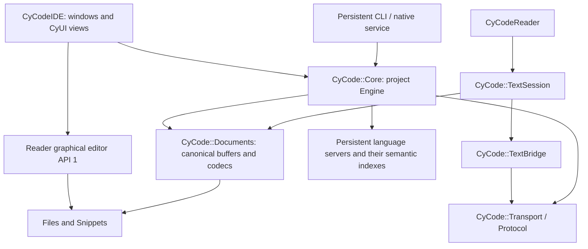

# CyCode native architecture and source integration

CyCode is the shared native C++20 library and headless service. CyCodeIDE owns the
desktop presentation; CyCodeReader owns its standalone editor presentation. The
existing Engine, language backends, project adapters, native plugins and guarded
transactions are reused. This development branch is not a new application release.

## Ownership



The native Core owns both project and standalone text profiles. They share
BufferState, encoding/newline primitives, guarded atomic I/O, native search,
process ownership, protocol envelopes and loopback transport. Reader's former
Document, Encoding, Search, Core, Plugins, NativeProcess and Bridge implementations
are retired from its build/source; compatibility headers retain its source names.
Core's duplicated app-level process sources/headers are retired too.

Project Engine retains workspace path restrictions, UTF-8 sources, identities,
revision issuance, recovery and multi-file transactions. TextSession retains
standalone paths, UTF-16/Windows-1252 support, read-only state, text transforms and
the existing text-plugin ABI. These are explicit profiles, not two semantic models.
Reader does not acquire project/LSP analysis just by linking the text profile.
Application-owned editor Undo/Redo and project change transactions are preserved.

## Source components

The root native source API, common source API and Reader graphical editor source
API are each version 1. These are source contracts, not a stable C++ binary ABI.
Use one pinned Core checkout per target graph; mixing Core copies is refused.

| Target | Responsibility |
| --- | --- |
| CyCode::Core | Existing project Engine, build/language/debug/VCS services and transactions |
| CyCode::Files | Paths and explicit guarded atomic text-file I/O |
| CyCode::Snippets | Native snippet parsing/expansion and byte ranges |
| CyCode::Documents | BufferState, codecs, Document and literal text search |
| CyCode::TextSession | Standalone live documents, revisions and text plugins |
| CyCode::TextBridge | Text-profile adapter for the common native protocol |
| CyCode::Process | Bounded argv-based processes, environment filtering and owned termination |
| CyCode::Transport | Authenticated loopback JSONL transport and endpoint lifecycle |
| CyCode::Protocol | Versioned request validation, typed failures and bounded response encoding |

Project plugins retain the versioned C ABI 1/2; text plugins retain their existing
ABI 1 names. Binaries from those two plugin profiles are not interchangeable. No
STL or ImGui object crosses either C boundary. Native plugins remain trusted code.

The Core catalogue exposes native services and no former desktop executable.
IDE staging derives only its display name and actual executable name; operation
IDs, schemas and permission declarations remain the canonical Core registry.
The IDE has its own CYCODE_IDE_VERSION, independent of the Core runtime version.
UI translations have one IDE-owned generator; Core's old write_locales.py entry
requires --ide-root and delegates explicitly, preserving the earlier script link.
Legacy application update compatibility code/resources remain available for the
historical release contract. The new IDE does not build the old updater helper,
and its development update panel does not offer the old product's update stream.

## Build and embed

```sh
python app/scripts/fetch_dependencies.py --core-only
cmake -S . -B runtime/core -DBUILD_TESTING=OFF
cmake --build runtime/core --config Release --target cycode_cli
```

Core fetch/configuration never requires Reader, CyUI, SDL, ImGui, OpenGL or
Tree-sitter. Native dependencies are pinned JSON, vterm, TinyXML2, Monocypher,
PCRE2 and utf8proc. The full Engine is the default. CLI, bundled providers and
update support default OFF when embedded; ordinary builds keep native tests OFF.

Text applications can fetch JSON only and select their components:

```sh
python app/scripts/fetch_dependencies.py --components TextSession TextBridge Process
cmake -S . -B runtime/text -DCYCODE_COMPONENTS="TextSession;TextBridge;Process" -DBUILD_TESTING=OFF
cmake --build runtime/text --config Release
```

An embedding may set CYCODE_COMMON_DEPS to its pinned dependency directory, include
`cmake/CyCodeComponents.cmake`, call `cycode_add_components(TextSession TextBridge)`
and link the explicit targets. Dependencies resolve automatically; unused optional
session/plugin or snippet libraries are not compiled. A full project host adds
the root Core directory and links CyCode::Core. Each Engine owns one project;
keep it alive across requests, join callers, then destroy it. TextSession does
not initialize project adapters or language workers.

## Native service contract

```sh
cycode_cli --disable-plugins <project> --stdio
cycode_cli <project> --serve <private-endpoint.json>
```

The stdio host emits a ready event, then accepts one bounded JSON object per line:

```json
{"protocol":"cycode-core/1","id":1,"method":"service.status","params":{}}
```

Responses preserve id/protocol and exactly result or error. Errors contain code,
message and optional details. Native owners emit RevisionConflict, DiskConflict,
ReadOnly, BackendUnavailable, Cancelled, DeadlineExceeded, CapacityExceeded and
UnsupportedOperation where migrated; other legacy runtime failures conservatively
remain OperationFailed. Classification never parses exception prose.

Request bound is 8 MiB; response bound is 20 MiB; string request IDs are at most
256 bytes. Stdio and socket output share one encoder. Oversized replies return a
correlated ResponseTooLarge. Socket transport bounds ordinary clients to eight,
with a control path for status/cancellation, timed reads and owned sockets. Failed
construction unwinds its resources; stopping joins handlers before borrowed state
can die. An old endpoint does not remove a newer instance's descriptor.

The descriptor protocols cycode-native/1 and cycodereader-native/1 remain compatible
and advertise coreProtocol. Text reports profile=text and no project analysis.
Protocol/id remain optional for legacy callers. Stdio service.shutdown or EOF
drains the host without saving buffers. Socket shutdown remains parent stdin/EOF;
these controls are not additional SDK/MCP operations. CyToolsCore still owns MCP,
jobs, identities, permissions and scheduling. One-shot CLI JSON remains legacy.

## Analysis and compilation context

service.status separates the service lifecycle from its Engine context.
language.status.servers reports each backend's configuration, observed launch,
initialization, capabilities, epoch, sent document revisions and version-bound
diagnostics. available means an observed running backend; an idle configured
command is not evidence of installation/readiness. Top-level ready/running remain
legacy aggregates; inspect the per-backend records. Sent revisions prove queued
notifications, not completed analysis. Whole-project index completeness is unknown.

CMake, MSBuild and Unreal continue to supply actual compiler commands, macros,
include/SDK/generated-file paths through their existing native adapters. clangd's
command model and index remain authoritative; path caches/literal search are
separate. Header command inference and background indexing have limits described
by [clangd compilation commands](https://clangd.llvm.org/design/compile-commands)
and [clangd indexing](https://clangd.llvm.org/design/indexing). Backend initialization
does not establish complete references across a project. Existing rename, code
actions and formatting retain previews, revisions, disk guards, explicit saves
and Undo; unsupported command-based transformations remain unavailable.

## Verified evidence and limits

Core 84e4c7831afeab27406a958a957db23fe005eae8 passed the native suite of 63
collected cases on Windows x64, Ubuntu x64 and macOS arm64:
[native acceptance](https://github.com/MrMybal/CyCode/actions/runs/42492881492).
The Windows-only MSBuild case is skipped on POSIX. The suite includes actual
language/debug backends, shared documents, protocol/lifecycle, endpoint ownership,
native projects and guarded transactions. Its existing POSIX Core case now also
checks 80 child processes launched by four concurrent callers, each verifying that
it actually owns the expected process group. No additional test executable was added.

The repeated macOS Git failures were captured as pre-execution setup exit 126,
not timeouts. The process launcher now checks the actual group postcondition
after the parent/child group requests and retains refusal when ownership is absent.
Failure paths report the setup stage and errno using allocation-free child writes.
The formerly failing replay passed the full suite (124.39 s) and three additional
repeats (120.42 / 122.06 / 118.46 s) on that revision. This records the tested scope;
it does not assert that every future Git or platform failure is eliminated.

Reader 671c588b924f9da2655843f64615b6b6bc7076e6 passed its 17 native/view contracts
on those three systems, plus the separate seven-case headless graph:
[Reader acceptance](https://github.com/MrMybal/CyCodeReader/actions/runs/42493128377).
This covers actual plugins, encodings, live revisions, disk conflicts, IPC/EOF,
shared syntax/editor, snippets with platform/custom completion chords, comparison,
Git history, filtering and CyUI views. These view cases open no OS windows. They
do not establish GPU, IME, physical desktop or multi-monitor acceptance.
Windows production builds of minimal libraries, CLI, Reader GUI and the IDE are
separate compile evidence; no app/helper/test binary was executed locally.

[Semantic run at 28c455b](https://github.com/MrMybal/CyCode/actions/runs/42480779142)
completed both a deterministic synthetic workload and the actual Core CMake project
(121 translation units, 230 owned source/header files, 1,773,202 bytes). Raw reports
are retained in Benchmarks/semantic-baseline-28c455b. On that Linux runner, five real-project
warm samples gave medians of 8.88 ms definition, 8.79 ms references, 303.82 ms
completion and 18.55 ms rename preview; first version-bound diagnostics took 2.91 s.
Instantaneous CLI/descendant RSS summed to 1,234,755,584 bytes. Shared pages may be
counted more than once; this is neither peak nor private memory. These are recorded
responses, not complete-index coverage, universal performance or an IDE comparison.

The post-consolidation [d0b179 run](https://github.com/MrMybal/CyCode/actions/runs/42485288360)
also passed, using 121 translation units / 227 owned files / 1,769,912 bytes. Raw
reports are in Benchmarks/semantic-baseline-d0b179. Real-project warm medians were
9.31 ms definition, 8.74 ms references, 269.26 ms completion and 18.52 ms rename
preview; first version-bound diagnostics took 2.26 s. Unsaved edits followed by
fresh diagnostics and definition had a 550.76 ms median. The report records actual
result shapes (including two observed references), persistent context/backend
epoch, untouched disk sources and instantaneous summed RSS 1,182,777,344 bytes.
This is a second observation, not a controlled optimization claim: the owned
source corpus changed when unused copies were retired. Neither run establishes
complete semantic coverage or large Unreal/MSBuild acceptance.

Regenerate only on an explicit GitHub runner with benchmark_semantic.py --ci.
--prepare-only produces source data locally without native execution. Reports carry
raw samples, corpus/compiler identity, source revision, response shapes and scope.
Process-cold is not OS-cache cold. Native execution remains suspended locally while
the existing antivirus removals are unresolved; no exclusions/restores are used.

## First measured response-path improvement

LanguageClient now signals its owning LanguageService when complete incoming
messages or transport termination arrive. A coalesced predicate under the service
mutex prevents a lost wake between predicate evaluation and waiting. Protocol and
semantic callbacks still run on the owner thread; the reader never edits Engine
state. The client joins its transport before captured wake state is destroyed.
The existing 8 ms timed housekeeping remains for deadlines and cancellation.
No second index, semantic model or unsaved-text cache was introduced.

The [93fe01c semantic run](https://github.com/MrMybal/CyCode/actions/runs/42488130338)
passed on the production CLI with real clangd. Both process runs retain the exact
same synthetic corpus hash, 33 translation units and compiler arguments as d0b179.
Observed warm medians, in milliseconds (first / second process run):

| Operation | d0b179, periodic wake | 93fe01c, incoming-response wake |
| --- | --- | --- |
| Definition | 8.28 / 8.30 | 5.08 / 5.08 |
| References | 9.03 / 9.00 | 5.14 / 5.13 |
| Completion | 8.37 / 8.54 | 5.07 / 5.10 |
| Rename preview | 18.75 / 19.27 | 10.89 / 10.37 |

These are separate hosted-runner observations, not a same-machine controlled
comparison or an IDE benchmark. The actual 121-unit Core CMake run also completed:
5.09 ms definition, 5.08 ms references, 454.13 ms completion, 10.18 ms rename
preview and 878.37 ms unsaved edit/diagnostics/definition median. Completion and
edit-to-analysis were slower in that observation than d0b179, so this does not
establish an overall analysis-speed improvement. Its own source corpus changed
with the implementation. Raw reports, result shapes and coverage/memory limits
are retained in Benchmarks/semantic-wakeup-93fe01c. Both workloads retained the
same Engine context/backend epoch and left source files unchanged on disk.

The [final 84e4c78 semantic run](https://github.com/MrMybal/CyCode/actions/runs/42492881444)
also completed both workloads. Raw reports are in Benchmarks/semantic-final-84e4c78.
Its real Core warm medians were 5.08 ms definition, 5.10 ms references, 498.33 ms
completion and 10.33 ms rename preview. First current diagnostics took 3.87 s and
the unsaved edit/diagnostics/definition median was 981.78 ms. Instantaneous summed
CLI/backend RSS was 1,223,716,864 bytes, with the same shared-page/coverage caveats.
The persistent context/backend epoch and unchanged disk sources checks passed.
These later observations continue to show that a faster short response path is
not an overall parsing/indexing/completion speed guarantee.

## Remaining development

Real large Unreal/MSBuild performance acceptance, complete context/dependency
invalidation coverage, incremental sync, concurrent/cancellation load baselines and
advanced clangd command-based transformations remain further engine work. No
CLion/IntelliJ parity is claimed. IDE installer/update identity and complete desktop
acceptance must be finished before a CyCodeIDE release; the historical updater is
disabled in this development build. The existing bilingual CyDoc manual stays
canonical in Core and is generated/staged by the IDE, preserving useful guides,
media, routes and public API schemas without a second documentation tree.

## Large-workspace continuation and local Unreal evidence — 2026-11-09

The owner explicitly authorized the production Core and installed Unreal tools
for this local engine checkout. This exception does not resume GUI launches,
local native test executables, antivirus exclusions or quarantine restores.
The original 154 local source changes remain separate and preserved.

workspace.files now publishes sorted immutable batches from one owned background
stream. A request budget returns progress instead of truncating the entire scan.
The IDE polls indexing/complete, validates page generations, has no former 32-page
assembly ceiling and builds its file tree off the UI thread. Page byte/count
bounds and real errors remain explicit. Path-index memory scales with file count;
this is not a disk-backed or semantic index. See Workspace.md for the contract.

On the measured Windows UE 5.5.4 checkout, the first reply took 507 ms. The warm
filesystem inventory completed in 2.87 seconds with 177,797 paths, identical to
an independent ignore-aware enumeration. Shutdown during a refreshed scan took
66 ms. The earlier 29.9-second first-page observation was not a controlled
comparison: truncated also described pagination, and the filesystem was warming.
It must not be presented as proof that paths were lost or as a universal speedup.

The real UBT database has 37,679 commands / 37,557 unique source files. Warm
foreground medians included about 16 ms definition, 48 ms completion and 32 ms
local rename preview. This measured nine edits in one actual engine function;
it does not prove exhaustive cross-engine references or multi-file rename coverage.
The engine-only adapter gap, raw measurement scope and memory caveats are recorded
in Unreal.md and Benchmarks/unreal55-windows-20261109.json. Raw private logs,
compiler command lines and engine source content are not distributed.

The extended transaction observation reproduced missing current-version
diagnostics after rapid Apply/Undo. C++ transaction sync now uses clangd's
documented wantDiagnostics checkpoint only after the server identifies as clangd.
Ordinary typing retains its debounce. Same-revision read coalescing preserves
the checkpoint; strict epoch/identity/revision checks remain unchanged and stale
publications are never relabelled. The exact failed case then passed on Unreal.
See https://clangd.llvm.org/extensions#force-diagnostics-generation.

Runtime validation tracks progressive index revision 4f50871 and transaction
revision 5dc05f4. The native matrix for the latter is
https://github.com/MrMybal/CyCode/actions/runs/42609650125 ; the new assertions live
in the existing native/Core and real-clangd cases, not new test executables.
