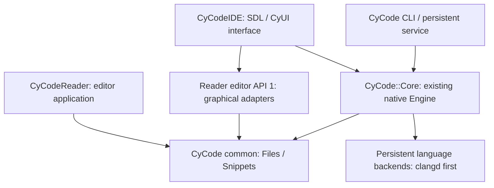

# CyCode native Core extraction — first delivery

## Diagnosis and evidence

The Engine, LanguageService/LanguageClient, document revisions, compiler adapters,
semantic transactions and authenticated `--serve` bridge already existed. They
are reused. Previously the CMake graph unconditionally added Reader/editor to
obtain Paths, TextFile and Snippet; the fetcher also checked out Reader in headless
mode. GUI targets and 66 UI/host translation units lived beside the Engine.

The native `didChange` implementation currently sends full document contents.
clangd runs with `--background-index`; its initialized/ready flag does not prove
that background indexing has covered a project. The path cache and literal
search are separate services and supply no semantic-index performance evidence.
Existing capability checks gate navigation, rename, formatting and code actions;
a backend capability is not acceptance of every possible refactoring.

Before extraction, native CI at ab827913944da95155e61f281cbe92aa2c337ec0
passed 64 Windows tests and 63 Linux/macOS tests, with the Windows-only MSBuild
case skipped on POSIX. These runs predate this extraction and are NOT runtime
validation of the new layout. No semantic latency or real-project memory baseline
has yet been established. No equivalence with CLion/IntelliJ is claimed.

## Ownership and dependency direction



CyCode owns the Engine, native contracts, compiler/project adapters and the common
native utilities. CyCodeIDE owns window lifecycle, UI views and their resources.
Reader currently consumes the canonical common targets; migrating Reader's richer
Document/Search/Bridge services to an optional Engine-based session is a subsequent
lot, not implemented merely by changing a dependency. No semantic model was added.

`common/` API 1 preserves headers, namespace and legacy target names. Reader's
six former native utility sources/headers are retired in its companion branch.
Source consumers use `CyCode::Core`, `CyCode::Files` and `CyCode::Snippets`.
Dependencies are locked archive sources. Core configuration/fetch/build has no
Reader/CyUI/SDL/ImGui/OpenGL/Tree-sitter requirement. Graphical dependency locks
and the desktop CMake graph moved to CyCodeIDE.

## Build and embed

```sh
python app/scripts/fetch_dependencies.py --core-only
cmake -S . -B runtime/core -DBUILD_TESTING=OFF
cmake --build runtime/core --config Release --target cycode_cli
```

The historical `cmake -S app` and `python app/scripts/build.py --core-only`
entry points remain available. Ordinary builds do not execute binaries or tests.
On Windows the wrapper finds Visual Studio 2022; direct CMake requires the normal
compiler environment/generator. For an existing dependency cache, set
`-DCYCODE_DEPS=<cache>`. There is no automatic dependency download at configuration.

A native host sets `CYCODE_DEPS` and adds this repository with `add_subdirectory`,
then links `CyCode::Core`. CLI, bundled providers and installation services default
to OFF when embedded and may be enabled explicitly. A small text editor may add
only `common/` with `CYCODE_COMMON_DEPS` instead of importing the whole Engine.
Each `Engine(workspace)` owns its project context; do not share an Engine between
unrelated projects. Keep it alive across requests and destroy it after joining
callers. Existing Engine destruction owns backend/plugin/job shutdown.

The old `CYCODE_BUILD_GUI=ON` now reports the new IDE repository explicitly.
It never silently substitutes a headless build for a requested IDE.

## Headless contract

```sh
cycode_cli --disable-plugins /path/to/project --stdio
cycode_cli /path/to/project --serve /private/endpoint.json
cycode_cli /path/to/project workspace.describe '{}'
```

`--stdio` emits a ready JSON line, then reads one bounded request object per line:

```json
{"protocol":"cycode-core/1","id":1,"method":"service.status","params":{}}
```

Responses retain `id`, `protocol` and either `result` or a structured `error`
with `code` and `message`. Request limit: 8 MiB; string ids: 256 bytes. Protocol
and id are optional for legacy requests. The stdio host control
`service.shutdown` drains/cancels owned build/test/project work, responds, then
exits through Engine destruction; EOF follows the same shutdown path. It does
not save documents. No Python, SDK or graphical initialization is involved.

`service.status` separates service lifecycle, Engine context identity and analysis
status. `language.status` remains the authoritative existing backend report,
including enabled/running/ready, capabilities, epoch and version-bound diagnostics.
Backend initialization does not certify full-project semantic completeness;
`projectIndexCompleteness` is explicitly unknown. Existing runtime_error-based
operations conservatively return OperationFailed rather than guessing error codes
from human-readable messages. Typed revision/backend errors are a later lot.

The existing loopback descriptor protocol remains `cycode-native/1` for SDK
compatibility and adds `coreProtocol`. Socket requests reuse CoreService's native
response envelope. Authenticated shutdown remains owned by the parent stdin/EOF;
the new stdio host command is not an added SDK/MCP operation.

## Reproducible measurements and next lots

`app/scripts/benchmark_semantic.py --ci --cli <binary> --clangd <binary>
--output <owned-report-directory>` is an explicit GitHub-runner-only benchmark.
`--prepare-only --output <directory>` generates its deterministic C++ corpus
without executing a native binary. The workflow is manual, distinct from normal
builds. Reports include raw samples, environment/compiler/backend identity,
process-cold versus persistent calls, version-bound diagnostics, guarded queries,
unsaved overlay checks and memory scope. Synthetic corpus results are not a
large CMake/MSBuild/Unreal project acceptance or a comparison with another IDE.

Subsequent coherent lots: run/capture the baseline; compilation-context and
invalidation acceptance on real CMake/MSBuild/Unreal projects; capability-driven
C++ transformations; incremental sync/cancellation only after measurement;
Reader session reuse and the standalone SDK/package API. Preserve prepared
transactions/revisions/disk guards and explicit saves throughout.

The historical application manual and old desktop verification scripts remain
preserved in this Core history during extraction. CyCodeIDE builds the same
canonical offline CyDoc export from Core, rather than forking its content or
contracts. Desktop packaging, installer/update repository identity and public
Pages relocation need a separate delivery before publishing an IDE release.
