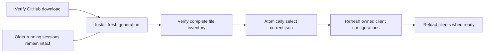

# CyCodeCore Manager

The current source replaces the old Win32 form with a standalone **CyUI Core**
desktop host. Agents/skills, dependencies and updates have separate views.
English/French, five themes, compact/comfortable density and DPI use CyUI's shared
controls. Preferences are retained per installation. Core itself remains UI-free.

## Private dependencies {#dependencies}

**Dependencies** detects clangd, ripgrep, Git, CMake, .NET, clang-tidy and lldb-dap
without executing them. A missing clangd opens this view on the first snapshot.
Other optional tools link to their official downloads; their installers are not
silently run. Compilers/build tools remain necessary for the corresponding tasks.

**Install private clangd** offers the official Windows x64 release **23.1.0**:
29,690,805 bytes downloaded, 101,011,414 bytes extracted, including built-in
headers and `LICENSE.TXT`. The executable alone is 51,872,768 bytes. Review the
source, destination and Apache-2.0 WITH LLVM-exception license before confirming.
CyToolsCore downloads with pinned size/SHA-256, resumption, progress and cancellation.
Archive paths are validated before extraction; files are verified before selection.

The destination is `<CyCodeCore>/dependencies/clangd/23.1.0/`, beside `versions/`.
`dependencies/clangd/current.json` selects an immutable version, so updating Core
retains the tool. No global PATH, registry or existing LLVM installation changes.
Explicit `CYCODE_CLANGD` overrides retain priority; otherwise native Core prefers
this private selection before bundled/PATH/system locations. Reload MCP clients
after installing/selecting a different version. `language_status` now distinguishes
`executablePresent`/`requiresInstallation` from an idle, lazily started backend.

## Compact MCP discovery {#mcp-profile}

New/refreshed managed connections default to **Code (compact)**. It advertises
19 common code operations, one `op_core_invoke` gateway and 21 official SDK
controls: **41 tools instead of 278**. Choose **Full catalogue** for existing
clients requiring individual names for all 257 native operations.

For an unadvertised capability, read `cy_list_operations` once, then fetch only
its exact `cy_describe_operation` schema. Call `op_core_invoke` with
`parameters: {operationId: "<canonical-id>", parameters: {...}}`. The official
SDK validates the actual operation's schema, permissions, resources and job owner;
the gateway grants no extra permission. Reuse advertised/discovered schemas and
avoid repeated complete discovery and speculative polling. `CYCODE_MCP_PROFILE`
or `--mcp-profile code|full` selects the presentation without changing native APIs.

With the pinned official SDK, serialized tool metadata measures **108,132 bytes**
for Code versus **1,570,677 bytes** for Full (93.1% less). These are byte counts,
not model token counts or a new agent speed benchmark.

## Agents and skills {#agents}

Open **CyCodeCore Manager** from the Start menu after installing Core 0.1.4 or
later. It replaces CyCodeUpdater. Core's installer no longer asks for a project
and never writes an agent configuration or installs a personal skill by itself.

1. Select one or more applications. Select **This project** or **My user account**.
2. Select **Install the CyCode Core skill**, **Configure the local MCP connection**,
   or both. A personal skill alone needs no project. An MCP connection always
   binds a specific existing project; it does not grant access to every folder.
3. Choose read-only access, or explicitly enable editing/build processes. VCS,
   native plugins and settings writes remain separate. Native plugins stay off.
4. Select **Preview changes**, review the target paths, then **Apply**. The manager
   retains other servers/settings and makes private backups before writing.
5. Trust/reload the connection in the selected client. File configuration is not
   proof that a client loaded the server, activated a skill or used a native tool.

The same official CyToolsCore MCP adapter is used for every client. A small
launcher allocates a separate SDK job-data directory for each host invocation;
clients and old/new generations never silently reuse a live SDK data root.
The manager never starts Core while preparing or applying configurations.

| Profile | Project MCP file | Personal MCP file | Skill location |
| --- | --- | --- | --- |
| Codex | `.codex/config.toml` | `~/.codex/config.toml` | `.agents/skills`; an already managed personal `.codex/skills` is retained |
| Claude Code | `.mcp.json` | `~/.claude.json` | `.claude/skills` |
| Cursor | `.cursor/mcp.json` | `~/.cursor/mcp.json` | `.cursor/skills` |
| VS Code / Copilot | `.mcp.json` | `~/.copilot/mcp-config.json` | project `.github/skills`, personal `~/.copilot/skills` |
| VS Code Local (legacy) | `.vscode/mcp.json` | `%APPDATA%/Code/User/mcp.json` | project `.github/skills`, personal `~/.copilot/skills` |
| Gemini CLI | `.gemini/settings.json` | `~/.gemini/settings.json` | `.gemini/skills` |
| Claude Desktop | not supported | `%APPDATA%/Claude/claude_desktop_config.json` | no local SKILL.md installation in this profile |

Codex uses TOML, VS Code Local uses a `servers` object, and the other JSON profiles
use `mcpServers`. Claude Code and native Copilot share the project `.mcp.json`
entry. JSONC comments and trailing commas in the VS Code Local profile survive
edits. Project scope skips a user-only profile rather than silently writing a
personal configuration. These are local profiles, not remote/cloud deployment.
Non-default client profile directories and organisation policies require manual
review. No client trust, approval or tool-filter policy is bypassed.

Use **Update managed connections** to preview a switch to the selected Core.
Issued legacy Codex receipts inside the installation are discoverable too. Only
an unchanged owned block/entry can be replaced; edited or unowned entries are
preserved and reported. Updating connections keeps their permissions and disabled
state, and does not overwrite modified personal skills. **Remove selected
connection** removes that owned MCP entry only, retaining unrelated settings,
personal skills and a private removal receipt.

Manager receipts, backups and SDK job roots live in the user's local application
data under `CyCodeCore/manager`, separated by installation. Backups can contain
private client settings. They are not part of the source or release package.

## Updates without replacing a running engine {#updates}

The **Updates** view checks GitHub once at startup and on manual request. A
separate, initially unchecked Setup option enables a daily Windows sign-in check.
There is no permanent polling service. Private releases require existing GitHub
authentication; failures are displayed as failures, never as an up-to-date result.

After explicit confirmation the manager downloads Setup, verifies size/SHA-256,
then opens the normal visible installer. Setup puts every payload in a fresh
`versions/<version>-<generation>/` directory. It does not delete, terminate or
overwrite the older Core, MCP host, Python runtime or manager. Even reinstalling
the same distribution uses a fresh generation. Legacy version-directory install
locations are normalised back to their installation root.

Only after all payload files pass their manifest checks does Setup atomically
publish `current.json`. A failed activation preserves the previous selection.
The manager waits for Setup and verifies the selected version before reporting
installation success. **Update owned MCP connections after installation** is a
separate visible option. Connection conflicts are reported separately from a
successfully installed Core; private skills are preserved. The manager then
reopens its selected version. Save/checkpoint unsaved agent edits before reloading
clients: old sessions keep their old buffers until explicitly closed.

Old generations are retained, including their recovery data. There is no automatic
recursive cleanup or forced process termination. Uninstalling still requires
closing clients using that installation. Personal client settings and backups are
retained. The portable package can launch the manager with `CyCodeManager.cmd`.

The 252 native operations and engine contract 0.2.3 are unchanged. These management
features do not implement another editor, semantic engine or SDK scheduler.

## Verification and limits {#validation}

The CyUI desktop host currently targets Windows/Direct3D 11 and uses CyUI keyboard
navigation, theme roles and DPI-scaled dimensions. Current Windows production
compilation and process-free SDK/file tests are
separate from acceptance in each agent application. Claude/Cursor/Copilot/Gemini
live connections and Linux/macOS management windows are not claimed as tested.
Visual/runtime acceptance of the new UI is pending. Core's earlier native
runtime/desktop validation retains its original provenance.

## Client references {#references}

Profile formats are based on the publishers' documentation:
[Codex skills](https://learn.chatgpt.com/docs/build-skills),
[Claude MCP](https://code.claude.com/docs/en/mcp) and
[skills](https://code.claude.com/docs/en/skills),
[Cursor MCP](https://cursor.com/docs/mcp) and
[skills](https://cursor.com/help/customization/skills),
[VS Code MCP configuration](https://code.visualstudio.com/docs/agents/reference/mcp-configuration)
and [skills](https://code.visualstudio.com/docs/agent-customization/agent-skills),
[Gemini MCP](https://geminicli.com/docs/tools/mcp-server/) and
[skills](https://geminicli.com/docs/cli/skills/).
